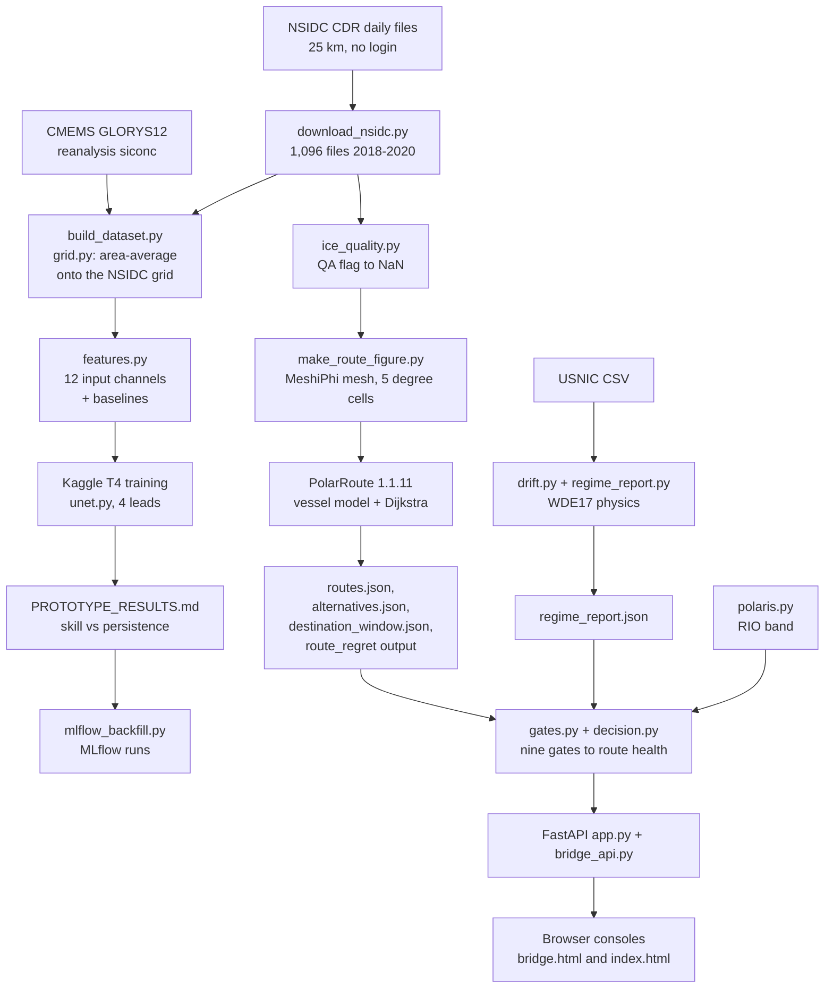
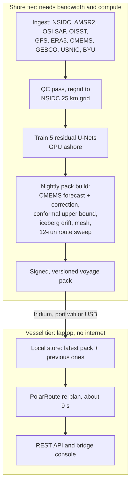

# Antarctic sea-ice navigation and iceberg-tracking system: a study guide for the research interview

This guide is for Jiteesh. It assumes you know nothing about the project and takes you from there to the point where you can explain it to a professor and defend it when he pushes back.

Dakshin is an advisory decision-support platform for India's Antarctic resupply voyages, motivated by an operational need stated by the Ministry of Earth Sciences (MoES) and its polar institute NCPOR: forecast Antarctic sea-ice concentration, predict iceberg trajectories, and find safe, fuel-efficient routes for research vessels. The source repo is `dakshin`.

Everything below comes from the repo: the docs, the code, and the data files. When a number appears, I say which file it came from. When the docs and the code disagree, I trust the code and say so. There is a list of those disagreements in section 11, and you should read it before the interview, because a professor who reads the repo will find them.

One more thing before you start. This project is unusually honest about its own weak points. The team wrote down what it cannot claim, withdrew a headline number that turned out to be wrong, and reported an experiment that came out against it. In an interview that honesty is your best asset. Do not oversell. If you say "we built a prototype that proves the architecture, and here is exactly what it does not yet do", you will sound more credible than someone who claims everything works.

## Contents

1. The 60-second version
2. The problem in plain words
3. The system at a glance
4. Background concepts, from zero
5. Where the data comes from
6. Data flow from end to end
7. A tour of the code
8. What is built and what is only designed
9. Why this and not that
10. What is new and what is standard practice
11. Limitations, and what you can and cannot claim
12. Questions the professor will probably ask
13. Glossary
14. Reference links
15. Numbers cheat sheet

## 1. The 60-second version

India sends one chartered ship, the MV Vasiliy Golovnin, from Cape Town to its two Antarctic stations, Bharati and Maitri, once a summer. The sea around Antarctica is full of sea ice that moves with the wind, and icebergs the size of cities that drift. If the captain picks a bad path, the ship loses days, burns fuel, or gets stuck.

The team built a decision-support system. It does three jobs. It forecasts where the sea ice will be over the next few days. It predicts where large icebergs will drift. And it feeds both into a route planner that finds a path.

Three design ideas sit at the centre of it.

First, the team did not try to forecast sea ice from scratch. A European service called Copernicus Marine already runs a physics model of the ocean and ice. The team's neural network learns the model's mistakes and corrects them. That is called bias correction, or residual learning.

Second, icebergs are handled with a published physics equation (Wagner, Dell and Eisenman, 2017) and not with machine learning, because there is very little iceberg tracking data.

Third, the routing is done by PolarRoute, an open-source tool from the British Antarctic Survey, not by a home-made algorithm.

The September prototype trains a small U-Net on real satellite data, beats a "yesterday's ice stays the same" baseline by 18 to 31 percent, routes a ship from Cape Town to Bharati with the real routing tool, and shows the result in a browser console. It also found a data problem: the satellite record writes some coastal cells as 0 percent ice when it actually means "I do not know". That problem hides the fact that Bharati's own cell was closed to the ship on 23 of 31 days in December 2019.

The honest summary of what is not done: no calibrated uncertainty yet, no iceberg trajectory forecast on real wind and current yet, the sea-ice model's output is not yet wired into the router, and the headline skill numbers are an upper bound because the background field was a reanalysis and not a true forecast.

## 2. The problem in plain words

### 2.1 Why the voyage is hard

Antarctica is surrounded by a ring of floating sea ice. It grows in winter and shrinks in summer, but even in summer it does not vanish. The Indian ship arrives in the austral summer, roughly December to February, when the ice edge has pulled back as far as it ever does. Even so, the last stretch to the coast can still be ice.

The ice is not a fixed wall. Wind pushes it, currents carry it, and it opens and closes. A gap that was open yesterday can be shut tomorrow. The ship cannot turn around quickly, and there is no port to run to. The repo's own research documents describe real cases of ships being trapped for weeks or months, including the MV Magdalena Oldendorff, which was beset near Novolazarevskaya in 2002 for about five and a half months (`docs/archive-hackathon/VIVA_PREP.md`).

On top of the sea ice there are icebergs. Some are enormous. The largest one in the catalogue the team downloaded, D15A, covers about 3,037 square kilometres. These giants drift slowly, but they matter because they can block approaches and because they are what the lookout and radar must watch for.

### 2.2 What the captain actually has to decide

The repo's own docs make the point that a voyage is not one decision. It is a series of decisions taken at different times (`docs/DECISION_ARCHITECTURE.md`). In plain terms the master needs answers to these:

- When should we leave, and when will we arrive?
- Which way do we go across the open ocean, and where do we turn south toward the ice?
- Will the last part, the approach to the station, be open when we get there?
- If it is shut, do we wait, or do we switch to moving cargo by helicopter and barge from the ice edge?
- Is the plan I approved still valid, and if not, what changed and what are my alternatives?

The team's most important finding, from real satellite data, is that the open ocean is the easy part. In `docs/PROTOTYPE_RESULTS.md`, about 5,800 km of the 5,813 km route has an average of only 6 percent ice. The hard part is the last 100 km. For December 2019, Bharati's own cell was closed to this ship on 23 of 31 days (74.2 percent), while the water 100 km to the north was open on all 31. The repo puts it in one line: the crossing is not the hard part, the last 100 km is.

### 2.3 Why this matters to MoES and NCPOR

NCPOR (the National Centre for Polar and Ocean Research) belongs to MoES and runs India's Antarctic programme. Each year's expedition charters the Golovnin from the Russian company FESCO. The 43rd expedition, for example, left Cape Town on 23 December 2023 (PIB press release, linked in section 14). One bad season costs a lot of money and puts people and cargo at risk.

The repo also records what exists today. An earlier Indian study (Mishra and co-authors, *Polar Science*, 2021) looked at optimum ship routes between Bharati and Maitri using ice and wind resistance, but without any treatment of uncertainty (`docs/TRUE_CLAIMS.md` section 2.2). The team frames that study as proof that the problem is recognised in India, not as a competitor to beat.

### 2.4 What "decision support" means here

The problem statement says decision support. The team takes that literally. The system does not steer the ship and does not replace the captain's judgement. In the demo, the master's intended route is evaluated first, and alternatives are shown with reasons. A route is not approved until a named person approves it, and approving adds a new version rather than overwriting the old one (`dakshin/decision.py`, `dakshin/workflow.py`).

## 3. The system at a glance

The repo's own viva guide boils everything down to three questions (`docs/archive-hackathon/VIVA_PREP.md`).

| Question | The team's answer | Where it lives |
|---|---|---|
| Where will the ice be? | A U-Net that corrects a physics forecast | `models/sic_correction/unet.py`, `dakshin/kaggle/` |
| Where will icebergs drift? | A published physics equation, no neural network | `models/iceberg/drift.py` |
| Which way should the ship go? | The British Antarctic Survey's PolarRoute, run on an ice mesh | `dakshin/make_route_figure.py`, `dakshin/ice_meshes.py` |

Around those three sit supporting pieces: a quality-control layer for the satellite data, a risk framework (POLARIS) used as a band rather than a number, a set of nine "decision gates" that decide whether a route is healthy, a workflow that walks the captain from planning to approval, and a web console that shows all of it.

It helps to hold two pictures in your head, because the repo contains both.

The first is the **final product design**. A shore tier with plenty of bandwidth and computing power downloads data, trains models and builds a small "voyage pack" each night. A vessel tier, a laptop on the bridge with no internet, receives the pack and runs the router locally. Most of this is described in `docs/ARCHITECTURE.md` and is design, not code.

The second is the **ISIH prototype**, which lives in the `dakshin/` folder and is what actually runs. It is deliberately kept separate from the final product so the two are never confused. The prototype shares exactly one thing with the final design: the U-Net file.

When you talk to the professor, say which of the two you mean. Mixing them up is the fastest way to say something false.

## 4. Background concepts, from zero

This section teaches every idea you need. Each one is short. Read it once straight through, then come back to individual pieces.

### 4.1 Sea-ice concentration (SIC)

Imagine looking straight down at a square of ocean 25 km by 25 km. If half the surface is covered by ice and half is open water, the sea-ice concentration is 50 percent. That is all the number means. It says nothing about how thick the ice is, how old it is, or whether the ice is in big floes or small chunks.

The repo stores SIC as a fraction from 0 to 1 in the model code and as a percent in the routing code. Be ready to say which you mean.

Concentration is the single most useful number for a ship because it roughly answers "can I get through here at all". But it is a blunt tool. A ship can sail through 60 percent thin new ice that would stop it in 60 percent thick old ice. This is why the repo spends so much time on POLARIS and thickness, which come later.

### 4.2 Passive microwave satellites

Antarctica is dark for months and usually cloudy, so ordinary cameras are useless. Satellites that measure sea ice use passive microwave sensors. "Passive" means they send out nothing. They just listen to the faint microwave energy that every surface gives off naturally. Ice and open water give off microwaves differently, so the pattern tells you how much of a patch is ice, day or night, cloud or clear.

The trade-off is coarse resolution. One measurement covers a footprint of tens of kilometres. NSIDC notes that a footprint on a coast can include both land and water, and the algorithm can mistake that mix for sea ice (NSIDC "Ask a Scientist", linked in section 14). A coastal footprint can also work the other way, which is exactly the bug the team found. More on that in section 4.9.

### 4.3 Polar stereographic grids

A map projection flattens the curved Earth. Near the poles, ordinary latitude and longitude grids go badly wrong because lines of longitude all meet at a point. Sea-ice data is therefore stored on a polar stereographic grid, which looks at the pole from above.

The grid used in this project is NSIDC's south polar stereographic grid, called EPSG:3412. Its centre is the South Pole and its standard parallel is 70 degrees south. Each cell is 25 km by 25 km. The full grid is 332 by 316 cells (the repo checked this against a real file: `docs/PROTOTYPE_README.md`). Because the grid is regular in projected coordinates, finding which cell a point falls in is simple arithmetic, which is what `dakshin/grid.py` does.

An analogy: a lat-lon grid is like a chessboard that gets squeezed into thin slivers near the poles. A polar stereographic grid is like looking down a well, where all the squares stay roughly the same size.

### 4.4 Observation, reanalysis and forecast

These three words describe three different relationships between data and time. Mixing them up is the single most dangerous mistake in this project, so get this clear.

An **observation** is something a sensor actually measured. The NSIDC sea-ice record is an observation product, built from satellite measurements.

A **forecast** is a prediction made at a particular time about the future. A forecast issued on Monday about Thursday cannot know what happened on Wednesday. Forecast error grows with how far ahead you look.

A **reanalysis** is a look back. Scientists run a model over past years and keep nudging it toward real observations as they come in (this nudging is called data assimilation). The result is a smooth, complete, physically consistent picture of the past. But because the observations were fed in as it went, the reanalysis value for a given day has already "seen" what happened around that day. It is not a forecast of that day.

Think of a weather forecaster. A forecast is what she said on Monday about Thursday. A reanalysis is the weather map somebody drew carefully on Friday, using every report that came in. The Friday map is better, but it is not a fair test of Monday's skill.

This matters because the prototype's model corrects a reanalysis (GLORYS12), not a real forecast. The repo calls this the sharpest question the team will be asked, and I come back to it in sections 8, 11 and 12.

### 4.5 GLORYS12, CMEMS and NOAA/NSIDC CDR

**CMEMS** is the Copernicus Marine Service, the European Union's operational ocean service. It publishes ocean and sea-ice data and forecasts. You need a free account to download from it.

**GLORYS12** is CMEMS's global ocean reanalysis at about 1/12 degree resolution (roughly 8 km), covering 1993 onward, with a sea-ice component. In the repo it is the dataset id `cmems_mod_glo_phy_my_0.083deg_P1D-m`, product `GLOBAL_MULTIYEAR_PHY_001_030`. The prototype uses its sea-ice concentration field (`siconc`) as the "background" to be corrected.

**The CMEMS operational forecast** is a different product, `GLOBAL_ANALYSISFORECAST_PHY_001_024`, which gives a 10-day forecast updated daily. This is what the final product is meant to correct. The prototype did not have a history of it, so the team started collecting it every day from 31 August 2026 (section 5).

**NOAA/NSIDC CDR G02202 version 6** is the "climate data record" of passive-microwave sea-ice concentration from NSIDC, at 25 km, daily, from 1978. It combines two algorithms (NASA Team and Bootstrap). In this project it is the "truth": the field the model learns to match. It needs no login.

An important detail: the truth is itself a satellite estimate with its own errors, and it is a 25 km product while GLORYS12 is about 9 km. When the model learns the difference between them, part of what it learns is just grid and algorithm mismatch, not physics.

### 4.6 Ice types, ice classes, POLARIS and RIO

Ships are built to different standards for ice. The IMO Polar Code, in force since 1 January 2017, sets rules for ships in polar waters. A ship has an **ice class**, such as Polar Class 5, or the older Finnish-Swedish classes like 1A. Higher classes can handle thicker ice.

POLARIS is a method inside the Polar Code guidance (IMO circular MSC.1/Circ.1519) for deciding how risky an ice regime is for a given ship. For each type of ice (new, grey, thin first-year, thick first-year, multi-year, and so on) and each ice class there is a Risk Index Value, called RIV, from 3 down to about minus 8. You multiply each ice type's share of the area, in tenths, by its RIV and add them up. The result is the Risk Index Outcome, RIO.

- RIO of 0 or more means normal operation.
- Below 0 means elevated risk (or "special consideration" for ships not in the Polar Class range).
- Below minus 10 means special consideration for everyone.

A key fact for this project: POLARIS is indexed by ice **type** (which tracks thickness), not by concentration. A concentration forecast alone cannot give you a RIO. You would also need a thickness or stage-of-development forecast. This is why the repo says an "80 percent ice limit" is only a working stand-in and not a regulatory number (`docs/NAVIGATION_RESEARCH.md`).

There is a second problem. The Golovnin carries an old Russian ice notation, KM(*) ULA, which has no row in the POLARIS tables. The Polar Code's own way to settle this is a ship-by-ship assessment approved by the flag state, with no lookup table by design. So the repo declines to print a single RIO number for the Golovnin. In `dakshin/polaris.py`, across plausible rows the RIO for the same ice swings between +19 and minus 21 on a regime like the Bharati approach. Picking one row would be picking an answer, not computing one.

### 4.7 Icebergs and drift

An iceberg is a chunk of ice that broke off a glacier or ice shelf. Giant flat-topped ones, called tabular icebergs, dominate the Southern Ocean. Roughly nine tenths of the mass sits below water.

Three things push an iceberg: wind on the part above water, ocean current on the large part below water, and the Coriolis effect, which bends any moving thing sideways because the Earth rotates (to the left in the Southern Hemisphere).

For giant bergs the current usually dominates, so an old rule of thumb ("icebergs drift at 2 percent of wind speed") fails for them. The team checked this on the real catalogue (`models/iceberg/regime_report.json`). Under typical forcing (10 m/s wind, 0.1 m/s current), 20 of 33 tracked bergs are current-dominated. Under storm wind (30 m/s) with a weak current, 28 of 33 become wind-dominated. The repo's own conclusion is that "large bergs move with the current" is a statement about typical conditions, not a property of the bergs. And storms are exactly when the forecast matters most.

Who tracks icebergs? The US National Ice Center (USNIC) names and tracks every Antarctic berg that is at least 20 square nautical miles or 10 nautical miles on its longest side, roughly 18.5 km. It publishes a weekly list. The BYU Center for Remote Sensing keeps a long history (1978 onward) built from scatterometer data and NIC reports. Anything smaller than the USNIC cutoff is not tracked by anyone globally. That includes growlers (about 5 m) and bergy bits, the pieces that actually hole hulls. The repo says plainly that this system cannot warn about them.

### 4.8 NetCDF files

Most of this data arrives as NetCDF files. Picture a spreadsheet with more than two dimensions: latitude by longitude by time, where every cell holds one number such as "38 percent ice here on this date". NetCDF is the standard file format for this kind of science data. The Python library xarray reads these files and lets you ask questions like "give me this one box of ocean over 30 days" without index gymnastics. Both the NSIDC and CMEMS files in the repo are NetCDF.

The NSIDC files also carry extra layers beyond concentration: a per-pixel quality flag, and a per-pixel standard deviation. These matter a lot (next two sections).

### 4.9 QA flags and the 0.0 percent trap

Every NSIDC daily file ships `cdr_seaice_conc_qa_flag`. It is a number where each binary digit means something: bit 1 and 2 are weather filters, bit 4 is "land spillover filter applied", bit 8 is "no input data", and so on.

The land spillover filter exists because a coastal footprint that overlaps land reads warm and can be mistaken for open water or for ice. So the producers suppress those cells. Here is the trap. When the filter fires, the product writes **0.0**, and 0.0 is inside the file's valid range of 0 to 100. A reader that only checks "is this a valid number" accepts it as open water.

The team noticed this because of physics. On 1 December 2019 a cell 35 km off Bharati read exactly 0.0 percent, sitting right next to cells reading 60 percent. Real ice does not do that. Real ice edges have gradients. Three days later the same cell read 90 percent. The ice never left. The retrieval did.

`dakshin/ice_quality.py` reads the flag and sets "land spillover" and "no input" cells to NaN, meaning "not a number", meaning unknown. Downstream, the mesh builder drops NaN cells and fills them from the surrounding parent cell, so an unknown coastal cell inherits its neighbourhood instead of claiming open water. The slogan in the code is that "I don't know" routes a ship more safely than a confident zero.

The team measured the problem over all 1,096 daily files from 2018 to 2020. The filter fires on 100 percent of days, suppressing about 118 cells per day on average. In the 200 km box around Bharati, suspect cells appear on 43.2 percent of days. They checked that masking moves the answer in the safe direction: mean ice in that box on 1 December 2019 goes from 46.8 percent to 54.6 percent. A residual caveat, stated in the repo: the parent-cell fill still gives 30 to 36 percent on artifact days when the surroundings suggest 80 to 95. The fix removes a confident wrong answer. It does not yet give a confident right one.

The "standard deviation" layer, `cdr_seaice_conc_stdev`, is the producers' own per-pixel uncertainty estimate. The team uses it once, to set the "marginal" band in the ice gate: the median value across the 70 to 90 percent concentration band in December 2019 is 7.4 points, so "marginal" means "within one standard deviation of the limit" (`dakshin/gates.py`).

### 4.10 Mesh-based route planning, Dijkstra and PolarRoute

A computer cannot search a continuous ocean. It needs a graph: nodes joined by edges with costs. The standard trick is to chop the map into cells, make each cell a node, join neighbouring cells, and give each connection a cost such as travel time.

A mesh is the cell layout. An adaptive mesh uses small cells where conditions change quickly (near the ice edge) and big cells where nothing much happens (open ocean). That saves effort without losing detail where it counts.

**Dijkstra's algorithm** finds the cheapest path through a graph by always expanding the cheapest reachable node first, like water spreading out fastest where the ground is easiest. It is guaranteed to find the best path, as long as the costs are right.

PolarRoute is open-source software from the British Antarctic Survey (BAS), under the MIT licence. It has two parts: MeshiPhi builds the adaptive environmental mesh, and PolarRoute models how fast a particular ship can go in each cell and runs Dijkstra with path smoothing. The team uses version 1.1.11. The PolarRoute authors ask users to cite their paper; the documentation page links to it.

Compare with plain A-star on a raw grid. A-star is a Dijkstra variant that uses a distance guess to search faster. The issue is not the search algorithm, it is everything around it: building a sensible mesh and converting ship physics into speeds. PolarRoute already does that.

### 4.11 Bias correction, residual learning and U-Net

**Bias correction** means: take a model that is good but systematically off, and learn the pattern in its errors. If the physics forecast says 40 percent ice and the satellite later says 55, and this happens repeatedly in similar conditions, a correction model can learn "add about 15 here".

**Residual learning** is the formal name for training a network to predict the *difference* (the residual) rather than the answer. The team writes it as:

`corrected SIC = clip( background SIC + predicted correction , 0 , 1 )`

where `clip` just forces the answer to stay between 0 and 1. Two benefits follow, both stated in the code. First, the last layer of the network is set to zero at the start (`nn.init.zeros_` in `unet.py`), so an untrained model outputs a zero correction and reproduces the background exactly. It starts at the background's skill and can only be judged on what it adds. Second, learning "how wrong is this forecast here" is a smaller problem than learning all of ocean physics.

A U-Net is a neural network for image-shaped data. The picture is a letter U. The left side repeatedly shrinks the image, so each deeper layer sees a wider area (fine detail first, big picture later). The right side expands it back up to one number per cell. Skip connections carry fine detail straight across from the left side to the right so it is not lost in the middle. U-Nets were invented for finding sharp boundaries in microscope images. Here the sharp boundary is the ice edge.

In the code (`models/sic_correction/unet.py`), the network has three shrinking levels, batch normalisation, and ReLU activations. Grids of 332 by 316 are not divisible by 8, so the code pads the input and crops the output.

### 4.12 Ensembles, uncertainty and conformal prediction

An **ensemble** is several models. If five models trained slightly differently agree, the situation is probably easy. If they disagree, it is uncertain. The spread is a raw signal of uncertainty. The final design calls for five members that differ by random seed and by jittering the inputs. The prototype has one model, not five.

But a spread is not a safety margin yet. A captain needs something like "we are 90 percent sure the true ice is below X". **Conformal prediction** is a method to get that. The recipe in plain words:

1. Take real past days the model never trained on.
2. For each day, compare the model's proposed upper bound to what actually happened.
3. Adjust the bound until, measured on those days, it is right the target fraction of the time (say 90 percent).

The guarantee is empirical and does not assume the errors follow a bell curve. That matters because concentration is bounded between 0 and 100 percent and ice-edge errors are lopsided. The design splits the check by lead time and by regime (open water, marginal ice zone, pack ice) and commits in advance to a pass/fail rule: coverage at lead 5 in the marginal ice zone must land between 85 and 96 percent. If it fails, the team says it will publicly demote its uncertainty claim and remove the risk slider from the interface (`docs/DECISIONS.md`, ADR-020).

**Be clear in the interview: conformal prediction is designed and specified, not implemented.** Searching the code for "conformal" finds only diagram-generator scripts. The prototype reports raw model output.

### 4.13 Persistence, RMSE and skill

**Persistence** is the simplest forecast: tomorrow equals today. It is a surprisingly strong baseline for ice because ice barely changes overnight. A model that cannot beat persistence adds nothing.

**RMSE** (root mean squared error) is the typical size of the error, with big misses counted extra. In this project it is computed on concentration as a fraction. An RMSE of 0.0465 means a typical error of about 4.7 percentage points of concentration.

**Lead time** is how far ahead you are predicting: a 3-day lead means predicting three days past the last observation.

**Skill** here is the percentage by which the model's error is smaller than the baseline's. "+18.5 percent" at one day means 18.5 percent less error than persistence.

### 4.14 Time-based splits and why they matter

When you train a model you hold some data back to test it. For daily geophysical fields, you must split by time, not randomly. If you split randomly, Tuesday goes to training and Wednesday to testing, and since ice barely changes overnight the test looks easy and the score is meaningless. The prototype splits the days in order: first 70 percent train, next 15 percent validation (used only to choose when to stop training), last 15 percent test, scored once. The repo records an earlier run that reported +27 percent by choosing the best of 30 epochs on the same data it then reported. That number was inflated and was discarded.

### 4.15 Kaggle, MLflow and the tooling

**Kaggle** offers free notebooks with GPUs. The team trained there (a T4 GPU, one to two hours for all four horizons) because it was free and it keeps the CMEMS password in Kaggle Secrets instead of on anyone's laptop. The trained checkpoints are not in the repo.

**MLflow** is an open-source tool that records experiments: parameters, metrics, models. Because the model was trained on Kaggle where MLflow could not watch, the script `dakshin/mlflow_backfill.py` logs the already-recorded results into a local MLflow store, one run per forecast horizon, each tagged as a backfill so nobody mistakes it for a live run. It copies numbers verbatim from `docs/PROTOTYPE_RESULTS.md` and refuses to invent any. The `mlruns/` folder is gitignored, so a fresh clone gets the script and not the runs.

**FastAPI** is a Python framework for web servers. It serves the demo's data and the web console.

### 4.16 Other terms you will meet

- Marginal ice zone (MIZ): the 100 to 200 km band between open water and solid pack ice, where conditions are most chaotic.
- Innovation: how wrong the background is against the newest real observation at a given cell. It is the most important input channel in the prototype.
- Ice edge error (IIEE): a score for how many cells are wrongly called ice or not-ice. Used in the final evaluation plan.
- CRPS: a score for the quality of a probability forecast. Also in the plan, not yet computed.
- Compression: ice pressing together under wind so it squeezes a ship. It is the hazard that traps ships, and no operational product forecasts it in the Antarctic. The repo calls this white space, with caveats.
- Besetting: when a ship is stuck in ice and cannot move.
- ASPA and ASMA: Antarctic Specially Protected Areas (entry needs a permit) and Specially Managed Areas (entry is allowed but must follow a management plan). Both come from Annex V of the Antarctic Treaty's environmental protocol.

## 5. Where the data comes from

The repo's rule is that every input traces back to a real satellite, a real weather model or a real ocean model. `docs/DATASET.md` records live checks of each source on 31 August 2026. The table below keeps only what the code actually uses or collects, plus the sources the design depends on but the prototype does not yet touch.

### 5.1 Data the code uses today

| Data | Provider and exact name | How it is fetched | Login needed | Used for |
|---|---|---|---|---|
| Observed sea-ice concentration (the "truth") | NOAA/NSIDC CDR G02202 version 6, south daily, 25 km | `dakshin/download_nsidc.py` reads the yearly directory listing at `noaadata.apps.nsidc.org/NOAA/G02202_V6/south/daily/<year>/`, then downloads each `sic_pss25_YYYYMMDD_F17_v06r00.nc` file with 6 parallel workers, 3 retries, and rejects files under 1,000 bytes | No | Model training target, QA audit, route mesh |
| Background sea-ice concentration | CMEMS GLORYS12 reanalysis, `cmems_mod_glo_phy_my_0.083deg_P1D-m`, variable `siconc` | `copernicusmarine.subset()` in `dakshin/build_dataset.py`, one year at a time, over the box 5 W to 85 E and 48 S to 80 S | Yes, a free CMEMS account (on Kaggle it sits in Kaggle Secrets) | The field the U-Net corrects |
| Daily CMEMS forecast cycles | CMEMS `GLOBAL_ANALYSISFORECAST_PHY_001_024`, dataset `cmems_mod_glo_phy_anfc_0.083deg_P1D-m`, variables `siconc`, `sithick`, `usi`, `vsi` | `scripts/harvest_cmems.sh`, run by the GitHub Actions workflow `.github/workflows/cmems-harvest.yml` | Yes, stored as GitHub secrets | Future training and acceptance testing of the corrected forecast |
| Iceberg positions and sizes | US National Ice Center Antarctic iceberg CSV, weekly | `models/iceberg/catalogue.py` downloads `usicecenter.gov/File/DownloadCurrent?pId=134`; the committed file is `data/icebergs/usnic_antarctic_20260902.csv` | No | Regime check, iceberg layer in the demo |
| Coastline | Natural Earth, public domain | `dakshin/coastline.py` fetches it once, clips it to the corridor, simplifies it, and commits `dakshin/figures/coastline.json` | No | Chart background |
| Protected areas | Antarctic Treaty Secretariat `apa_shape_2024.zip` | `dakshin/download_protected_areas.py`; `dakshin/protected_areas.py` builds a committed extract | No | Station-operations constraints |
| Ship dimensions | Four independent registries, recorded in `docs/research/VESSEL_SPECIFICATIONS.md` | Hand-entered into `dakshin/ice_meshes.py` | n/a | Vessel model |

A few practical details are worth knowing, because a professor may ask how robust the pipeline is.

The NSIDC downloader does not guess file names. Different satellites supply the record over the years, and the platform code appears in the file name, so the script reads the real directory listing. It also refuses to report success if it finds no files. The result was 1,096 files for 2018 to 2020 with zero failures (`docs/PROTOTYPE_RESULTS.md`).

The CMEMS harvest exists because forecasts cannot be recreated afterwards. CMEMS overwrites each daily bulletin with the next one, so a missed day is gone. The workflow therefore runs twice a day, at 12:23 and 17:23 UTC. Both times are deliberately after 12:00 UTC, which is when CMEMS guarantees the daily bulletin (the comment in the workflow cites the product user manual). The second run costs nothing, because the script exits early if the day's file already exists. Before the fix, the job was firing four to five hours late on the hour, so the workflow now uses an odd minute. The harvested file is compressed from roughly 42 MB to about 4 to 5 MB per day using 16-bit packing, with a worst-case error three orders of magnitude below what any later step needs (`scripts/compress_netcdf.py`). At the time of this clone the archive holds 79 daily files, 31 August to 17 November 2026, with no gaps.

The catalogue loader refuses to invent data. If the USNIC feed is unreachable it raises an error. It does not fall back to made-up icebergs.

### 5.2 Data the final design needs but the prototype does not use

| Data | Source | Why the design wants it | Status |
|---|---|---|---|
| Wind, air temperature, waves | ECMWF ERA5 (training, free CDS account) and NOAA GFS (live forecast, no login) | The physical drivers of ice motion, and wave penalties for the ship | Not downloaded. The model has no wind or temperature input today |
| Sea-surface temperature | NOAA OISST v2.1, no login | Extra model input | Not downloaded |
| Seafloor depth | GEBCO gridded bathymetry, no login | Under-keel clearance | Not downloaded. The vessel's 20 m minimum depth currently does nothing, and the code says so (`dakshin/gates.py`, `chart_gate`) |
| A second ice source | AMSR2 (12.5 km), EUMETSAT OSI SAF (free account) | An independent check, so disagreement between sources can widen caution | Designed only |
| Radar imagery | Sentinel-1 via the Copernicus Data Space | Ice edge and iceberg detection through darkness and cloud | Not used |
| Long iceberg history | BYU/NIC database, 1978 to 2025 | Training a correction to the iceberg physics | Not used |

### 5.3 Data that does not exist

The repo notes one gap openly. There is no downloadable "safe ice shipping lane" dataset for Antarctica from IHO or anyone else. Official electronic charts are licensed and thin in Antarctic waters. This is not a research failure. Computing that route is the product's job. Equally, there is no observational Antarctic ice-drift product for December to March, which is why compression cannot be forecast yet (`docs/TRUE_CLAIMS.md` section 2.5).

## 6. Data flow from end to end

There are really three flows in the repo, and it helps to keep them apart. The first is the real-data pipeline that produces the model and the routing results. The second is the demo that serves those results. The third is the final design that has not been built.

### 6.1 The real-data pipeline that exists today

Two things to notice. The trained model (left branch) and the router (right branch) do not meet. The router is fed the observed NSIDC ice, not the model's corrected output. The trained checkpoint lives on Kaggle and is not in the repo. The doc `docs/PROTOTYPE_README.md` states that model inference is not in the demo, and that the skill numbers are shown as text with their caveats. This is the most important structural fact about the prototype, and you should say it before a professor asks.

### 6.2 Step-by-step walk-through

**Step 1. Download the truth.** `download_nsidc.py` pulls daily NSIDC concentration files for 2018 to 2020. Each file is a NetCDF holding the concentration on a 332 by 316 polar grid, a quality flag layer, and a standard deviation layer.

**Step 2. Fetch and regrid the background.** `build_dataset.py` downloads GLORYS12 `siconc` for the corridor and year. GLORYS12 sits on a latitude-longitude grid at about 9 km, finer than NSIDC's 25 km. The class `GlorysToNsidcRegridder` in `dakshin/grid.py` converts every source cell's position into the NSIDC projection, works out which target cell it falls in, and averages. Area-averaging, not bilinear interpolation, is the correct operation when you are going from fine to coarse, because bilinear would throw away most source cells and not preserve ice area. The mapping is computed once and reused for every day. The design rule recorded in the file is that the truth is never resampled: the finer field is moved onto the truth's grid, because resampling the field you score against would create edge artifacts that look like model error. Cells with no source point stay NaN, because an empty cell is unknown, not ice-free.

**Step 3. Pair and align.** Dates present in both sources are kept. A day missing from either is dropped, not interpolated. A validity mask marks cells where both fields are present. Nothing is imputed, because filling gaps would train the model on fiction.

**Step 4. Build the model inputs.** `features.build_channels` makes 12 channels for a chosen lead time. Channel 0 is the background valid at the target date. Channels 1 to 7 are the last seven real satellite observations. Channel 8 is the innovation: the background today minus the newest observation, which tells the network how wrong the background is right now at this cell. Channels 9 and 10 are the sine and cosine of the day of year, so the model knows the season. Channel 11 is the valid mask. A sample is only built when the seven-day history and the gap to the target are both truly consecutive days.

**Step 5. Compute baselines before training.** `evaluate_baselines` scores raw background, background plus a constant offset, background plus a per-pixel average bias map, and persistence. They are computed first, so the bar is fixed before the result is known. The per-pixel bias map is the strongest trivial method, and the repo explicitly says that if it matches the network, the network is decoration.

**Step 6. Train.** The Kaggle notebook (generated by `dakshin/kaggle/make_notebook.py`) trains one U-Net per lead time (1, 3, 5, 7 days). Settings from the notebook: 12 input channels, 32 base filters, depth 3, so 1,929,601 parameters; the Adam optimiser at learning rate 0.001; batch size 8; a masked mean squared error loss, where only valid cells count; the learning rate halves when validation stops improving; training stops after 12 epochs without improvement, up to 60; mixed precision on the GPU; the same random seed at every lead so the horizons are comparable. The split is 70, 15, 15 percent in time order. The training years are 2019 and 2020 only.

**Step 7. Score once.** The test slice, the last 15 percent, is scored exactly once. Section 8 gives the results.

**Step 8. Quality-check the ice for routing.** For the routing branch, `ice_quality.load_sic` reads the NSIDC file, keeps only values from 0 to 1, and sets land-spillover and no-input cells to NaN.

**Step 9. Build the mesh.** `make_route_figure.nsidc_to_dataframe` converts the polar grid to latitude-longitude points (every second cell, since the mesh is far coarser than 25 km) and writes concentration in percent. `build_mesh` hands this to MeshiPhi with 5 degree starting cells that split up to depth 4 where the ice varies (the split threshold is 35 percent concentration). NaN points are dropped and MeshiPhi fills them from the parent cell. Two more layers, ice thickness and ice density, come from MeshiPhi's built-in lookup tables, which are literature-derived seasonal and regional values and not measurements. The code comment explains why they are wired in: without them, the ice-resistance part of the ship model silently does nothing.

**Step 10. Apply the ship.** `VesselPerformanceModeller` takes the mesh and the Golovnin configuration (30.4 km/h service speed, 22.4 m beam, 20 m minimum depth, 3.0 m maximum wave, 80 percent maximum ice concentration). It marks each cell accessible or not and gives a speed per heading. The 80 percent limit is a working stand-in, not an ice-class number.

**Step 11. Route.** `RoutePlanner` runs Dijkstra on that vessel mesh from Cape Town (33.9 S, 18.4 E) to Bharati (69.4 S, 76.2 E) and smooths the path. The result for 1 December 2019 is 41 legs and 8.58 days of steaming over about 5,813 km (`docs/PROTOTYPE_RESULTS.md`).

**Step 12. Run the experiments.** Four scripts probe that machinery against real data:

- `destination_window.py` asks, for each of 31 days, whether Bharati's cell and an approach point 100 km north are passable. Result: Bharati closed 23 of 31 days, the approach 0 of 31.
- `route_regret.py` replays a plan through the ice that actually happened, to measure the cost of sailing on stale information. Result: essentially none on the one date tested (section 8).
- `alternatives.py` re-solves with different ice limits and records what breaks.
- `audit_ice_quality.py` measures how widespread the spillover problem is.

**Step 13. Assess the route with gates.** `gates.evaluate_all` checks nine gates. Only three can be judged from real data (ice, logistics and contingency); six return UNKNOWN and name the dataset that would settle them. `decision.health_from_gates` turns the gate states into a route health: VALID, DEGRADED, CRITICAL or INVALID. There is no score. Health is the worst gate state, and the gate that caused it is carried along as the reason. Any UNKNOWN gate caps health at DEGRADED. The code comment gives the reasoning: a system that reports VALID while blind to the chart and the weather would be lying by omission, and telling a master a route is fine when it is not is the expensive error.

**Step 14. Show it.** The FastAPI app (`dakshin/demo/app.py`) serves JSON and static files. A browser console draws the chart on a canvas, with no map tiles, fonts or CDN, so it runs with no internet. At startup it refuses to proceed if any day in the window has no satellite file on disk, and it warms all 31 days into memory (about 3 seconds), so a slider cannot fail mid-demo.

### 6.3 The second flow: the synthetic bridge console

There is a second thing in the demo that you must not confuse with the real pipeline. The default page (`/`) serves `bridge.html`, a more elaborate "bridge console", and it runs on a **synthetic world**. The folder `dakshin/sim/` builds seeded fields for pressure, wind, ice, sea-surface temperature, waves, visibility and icebergs. The code describes it as real physics with synthetic initial conditions. The equations are real (wind from the pressure gradient, clockwise flow around a southern low, waves damped by ice), but the state they run on is invented. The page carries a badge reading SYNTHETIC ENVIRONMENT, and every panel has a provenance dot: no dot for real, one for synthetic, two for simulated (`dakshin/demo/static/provenance.js`).

The synthetic world exists because the real pipeline cannot yet show a time-aware route. `dakshin/sim/router.py` is a Dijkstra search where the cost of entering a cell uses the ice and weather valid at the time the ship would arrive, which is what a forecast-aware router must do. In this simulated world, fuel and time are not the same objective, because speed is cut by ice and sea state while fuel rises with the cube of speed. Icebergs are stepped forward in time with the real Wagner equations, but on synthetic wind and current.

The real December 2019 replay still exists at `/legacy` (`index.html`). The older docs describe that page as the default. The code says otherwise (section 11).

A third page, `/future`, holds two simulated ideas, "Baymax Mode" (a fatigue aid) and a templated "master's assistant". Both are labelled SIMULATED and "NOT A LANGUAGE MODEL". The repo deliberately keeps them off the main console so a judge cannot ask "so what else here is fake?".

### 6.4 The final-product flow (design, not code)

The key idea (ADR-002 in `docs/DECISIONS.md`) is that the boundary between the two tiers is set at "sync environmental state, not answers". The vessel gets enough data to run the router itself, so the master's next "what if" question can be answered offline. A thin client that only receives finished routes cannot do that, and then it stops being decision support. The team measured that the whole PolarRoute pipeline runs in about 9 seconds on an ordinary CPU. This is the measurement that justifies putting the engine on the ship.

Pack size is a build-breaking constraint in the design: 50 KB per daily update and 1 MB for a full corridor refresh (ADR-017). What has actually been measured is thinner than the docs first claimed. The older docs quote 76 KB for a mesh sample and 796 bytes for a route line. The later correction register replaces the pack figure with a measured 7.8 KB daily pack produced by the demo's `/offline` endpoint, which builds and gzips the real payloads. Neither number covers a full corridor refresh. That one is still an estimate.

## 7. A tour of the code

### 7.1 File map

| File | What it does | Inputs | Outputs |
|---|---|---|---|
| `models/sic_correction/unet.py` | The residual U-Net, plus `apply_correction` (add and clip) | A tensor of channels | A correction in fraction units |
| `dakshin/download_nsidc.py` | Downloads NSIDC daily ice files | Years | `.nc` files |
| `dakshin/grid.py` | Polar-grid geometry and area-average regridding of GLORYS12 | Two grids | A field on the NSIDC grid |
| `dakshin/build_dataset.py` | Pairs GLORYS12 and NSIDC per year | NSIDC files, CMEMS download | `isih_pairs_<year>.npz` and a manifest |
| `dakshin/features.py` | Builds 12 input channels and the baselines | Aligned arrays, a lead | Inputs, targets, masks, baseline scores |
| `dakshin/kaggle/make_notebook.py`, `isih_train.ipynb` | Generates and holds the training notebook | n/a | Trained checkpoints, skill table (outputs not saved in the repo) |
| `dakshin/mlflow_backfill.py` | Logs recorded results into MLflow | Numbers copied from `docs/PROTOTYPE_RESULTS.md` | MLflow runs |
| `dakshin/ice_quality.py` | Reads QA flags, masks suspect cells, detects "hard zero next to ice" | One NSIDC file | Cleaned ice, a suspect mask |
| `dakshin/audit_ice_quality.py` | Measures the spillover problem over all days | The archive | `ice_quality_audit.json` |
| `dakshin/make_route_figure.py` | Builds a MeshiPhi mesh from one day of ice and routes | One NSIDC file | A mesh, a route |
| `dakshin/ice_meshes.py` | The Golovnin config, cached daily vessel meshes, point lookup | A date | Vessel-performance mesh |
| `dakshin/destination_window.py` | Is the station open each day? | 31 days | `destination_window.json` |
| `dakshin/route_regret.py` | Cost of planning on old ice (static versus daily re-plan) | A departure date | Voyage outcomes |
| `dakshin/alternatives.py` | Alternative corridors at different ice limits, two-ship comparison | A date | `alternatives.json`, `vessel_comparison.json` |
| `dakshin/plot_route.py` | Draws the route figure and measures its own annotation | Route data | `route_map.png` |
| `dakshin/polaris.py` | POLARIS RIO as a band across plausible ice classes | Concentration, a declared ice stage | Tier and speed limit per leg |
| `dakshin/gates.py` | Evaluates the nine decision gates | Evidence | Gate results |
| `dakshin/decision.py` | Decision, gate and route-health objects | Gate results | Route health and binding reasons |
| `dakshin/workflow.py` | The passage workflow as a state machine | Actions | State or an error for an out-of-order step |
| `dakshin/coastline.py`, `protected_areas.py`, `download_protected_areas.py` | Coast and treaty-area layers, built offline and committed | Natural Earth, ATS shapefile | Small JSON extracts |
| `models/iceberg/drift.py` | The Wagner, Dell and Eisenman closed-form drift velocity | Wind, current, latitude, berg size | A velocity |
| `models/iceberg/catalogue.py` | Fetches and parses the USNIC catalogue | The CSV | A table in SI units |
| `models/iceberg/regime_report.py` | Which regime (wind or current dominated) the real bergs are in | Catalogue plus a declared wind and current sweep | `regime_report.json` |
| `dakshin/sim/*` | The synthetic Southern Ocean world and a time-aware router | A seed and a time | Fields, bergs, traffic, warnings, routes |
| `dakshin/demo/app.py`, `bridge_api.py` | The web server and the API behind the console | Files on disk, the world | JSON |
| `dakshin/demo/data.py`, `decision_service.py`, `workflow_service.py`, `voyage.py` | Join real artifacts to the domain model; own-ship state; alerts | Files on disk | Decisions, alerts, waypoints |
| `dakshin/demo/static/*` | The browser consoles (canvas chart, provenance dots, workflow screens) | API | The interface |
| `scripts/harvest_cmems.sh`, `.github/workflows/cmems-harvest.yml` | Daily CMEMS forecast archive | CMEMS credentials | `data/cmems_forecast_archive/*.nc` |
| `scripts/compress_netcdf.py` | Shrinks harvested files | A `.nc` file | A packed `.nc` |
| `scripts/gen_*_drawio.py` | Generate architecture diagrams | n/a | draw.io files |
| `scripts/verify_claims.py` | Checks quoted numbers against the figure files | The JSON outputs | Pass or fail lines |
| `dakshin/test_*.py`, `dakshin/sim/test_sim.py`, `dakshin/demo/test_*.py`, `models/iceberg/test_drift.py` | Tests | n/a | n/a |

### 7.2 The pieces that matter most

**The U-Net (`unet.py`).** Two details a professor may probe. The docstring records that the model's default settings (19 channels, 40 base filters, about 3.0 million parameters) describe the final design, and that the trained prototype is smaller (12 channels, 32 filters, 1.93 million). The corrections register lists this mismatch as open. The other detail is the last layer initialised to zero, which makes "do nothing" the starting behaviour.

**The QA layer (`ice_quality.py`).** This is the module that found the project's most interesting result. It is small, and the logic is simple: read the flag bits, set bits 4 and 8 to NaN, keep the interpolation bits because an interpolated value is still an estimate. The helper `hard_zero_next_to_ice` is a second detector that needs no flag at all: an exact 0.0 touching ice above 50 percent is not physical. It works on products that ship no QA layer.

**The vessel mesh (`ice_meshes.py`).** It holds the ship configuration and caches meshes by date and by a hash of the entire vessel config, so changing the ship cannot silently serve a mesh built for another. The comment block lists three uncalibrated parameters that the team says out loud: the force limit (copied from BAS's own ship, RRS Sir David Attenborough), the 80 percent ice limit, and the wave limit, which PolarRoute applies only as a hard cut-off.

**Gates and decisions (`gates.py`, `decision.py`).** The nine gates are capability, chart, ice, weather, traffic, logistics, communications, contingency and execution. Each has a plain question, such as "Can this ship legally and physically operate here?". Each result carries evidence with a real file path as provenance, never a prose description. The unusual design choice is that UNKNOWN is a first-class state. The module docstring says that of nine gates, three can be judged from real data and six cannot, and that route health therefore tops out at DEGRADED. A wall of green lights would be easy to produce and easy for a judge to take apart.

**POLARIS (`polaris.py`).** It stores the RIV table from Circular 1519 Table 1.3, computes the single-stage reduction `RIO = C x RIV(stage) + (10 minus C) x 3`, and then reports a band across the plausible classes (PC4 down to Class IA by default). Its states are "stable-normal" (the class question does not matter here), "flips" (the candidate rows disagree about the tier, which is where a ship certificate would change the answer) and "stable-nonnormal". The ice stage must be declared by an officer, with no default, because a default would be an invented observation. Every response is labelled "single-stage reduction, not the IMO RIO". One gap against the research doc: `speed_limit_kn` returns nothing for PC1 and PC2, while `NAVIGATION_RESEARCH.md` lists 11 and 8 knots for them.

**The iceberg drift model (`drift.py`).** It implements the Wagner, Dell and Eisenman (2017) closed form:

`v_iceberg = v_current + gamma x ( alpha x (k cross v_wind) + beta x v_wind )`

In words: the berg moves with the surface current, plus a wind-driven correction that is partly along the wind (beta) and partly across it (alpha). Height cancels out, so only the berg's size matters, through one length. There is nothing to integrate, so it cannot go numerically unstable. The file documents three traps that give plausible-looking wrong answers: the preprint swaps the two drag coefficients relative to its own reference code (using the text's values puts a key constant 44 percent low), the Coriolis term must use its absolute value, and the printed alpha and beta lose precision. A test file with 23 tests reproduces the paper's coefficient table and its 765 m critical length. One more disclosed choice: the reference code deflects bergs to the right of the wind at every latitude, because the paper's quantitative work is Arctic. The team flips it left in the Southern Hemisphere from the sign of the Coriolis term. This is marked "inferred" in the code, and is nearly moot for giant bergs where wind barely matters.

An important limit: `drift.py` returns an instantaneous velocity. It has no time stepping. No real berg has been advanced in time on real wind and current, and no trajectory error has been measured. The sim folder does step bergs forward, but on invented forcing (`docs/archive-hackathon/VIVA_PREP.md` makes this point forcefully).

**The workflow (`workflow.py`).** A state machine with ten stages: sign in, command centre, voyage, mission, route, waypoints, review, approved, active, and a decision workspace. A route cannot be approved before it is reviewed, and cannot be reviewed before a mission says what "good" means. The mission matters in a concrete way: its destination policy ("must reach the station" or "the approach is acceptable") decides whether the logistics gate passes on a given day, so changing that single field changes route health on real observations. Sign-in is identity, not security. It records who is on watch. There is no user store, and the UI says so.

**The tests.** There are unit tests for gates, decisions, workflow, protected areas, the synthetic world and the drift model, plus `dakshin/test_behavioural.py` with about a dozen behavioural tests (for example that alternatives differ measurably, that absence of iceberg data is never reported as "no icebergs", that every replay is labelled, and that no capability is claimed without data behind it). The demo tests assert that the published numbers come out unchanged from the files on disk. I could not run them here, because the environment had no PyTorch or PolarRoute, so treat the test counts as what the files contain, not as a result I saw pass.

## 8. What is built and what is only designed

This is the section to learn best. The repo's own rule in `docs/TRUE_CLAIMS.md` is that if a claim is written there, the team can put the evidence on screen in under thirty seconds. Anything else is "designed, not yet built".

### 8.1 Status by component

| Component | Prototype today | Final-product design |
|---|---|---|
| Sea-ice correction model | A single residual U-Net per lead, 12 channels, 1.93 million parameters, trained on 2019 and 2020. Checkpoints are on Kaggle, not in the repo | Five members, 19 channels (adds wind, temperature, sea-surface temperature, lead time, QC fraction), trained 1993 to 2024 |
| What it corrects | A GLORYS12 reanalysis | The real CMEMS 10-day forecast |
| Uncertainty | None. Raw output | Stratified conformal bound with a pre-committed pass/fail rule |
| Model output reaching the router | No. The router uses observed NSIDC ice | A conformal upper bound replaces the plain average in the ice threshold |
| Iceberg physics | Closed-form velocity, tested; regime check on the real catalogue | Time-stepped trajectories on real wind and current, capped at 72 hours, with a learned correction |
| Iceberg learned correction | Not built | Gradient boosting, evaluated leave-one-iceberg-out |
| Iceberg hazard in the router | Not wired in `dakshin/` | Injected through PolarRoute's `excluded_zones` setting |
| Routing | PolarRoute on one frozen mesh per day, observed ice | Time-expanded graph (one ice layer per forecast day) and a 12-run candidate sweep |
| Quality control | QA flag masking applied to the routing ice. The model's own training data was not masked | One QC pass for all sources, feeding the model too |
| Bathymetry | Absent. The depth constraint is inert | GEBCO with a larger safety margin where depth is predicted rather than surveyed |
| POLARIS | A band across plausible classes, advisory | Needs a thickness forecast |
| Offline operation | The demo runs with no network and no map tiles | Signed packs, rollback, USB for model weights |

### 8.2 The model's results

From `docs/PROTOTYPE_RESULTS.md`. These are test-slice numbers, RMSE as a fraction of concentration, lower is better.

| Lead | Our model | Persistence | Background plus pixel bias | Raw GLORYS12 | Gain over persistence |
|---|---|---|---|---|---|
| 1 day | 0.0465 | 0.0570 | 0.1461 | 0.1630 | +18.5% |
| 3 days | 0.0720 | 0.0958 | 0.1461 | 0.1630 | +24.9% |
| 5 days | 0.0938 | 0.1204 | 0.1468 | 0.1637 | +22.1% |
| 7 days | 0.0968 | 0.1395 | 0.1468 | 0.1637 | +30.6% |

How to read it. Raw GLORYS12 is a poor match to the satellite truth (0.163) because of grid, algorithm and ice-model differences. Adding a fixed per-pixel bias helps a little (0.146). Persistence is much better than either, and the neural network beats persistence at every lead. The model's error grows 2.1 times from day 1 to day 7 while persistence's grows 2.5 times, so the advantage is largest at the longest lead, which is the horizon a voyage plan actually uses.

Why the team trusts the protocol: time-ordered split, test scored once, baselines computed before training, and an earlier inflated result discarded.

Three traps in quoting these numbers, all documented in the repo.

First, never mix test-slice persistence (0.0570, 0.0958, 0.1204, 0.1395) with full-year persistence (0.0359 at 1 day, 0.0610 at 3, 0.0893 at 7). The full-year numbers are lower because winter days, when ice barely moves, are averaged in. The test slice is the austral melt season (roughly the last 15 percent of 2019 to 2020, which is the back end of 2020), when persistence is weakest. Quoting 0.0893 beside the model's 0.0968 would make persistence look like it wins at 7 days. It does not. The periods differ.

Second, validation scores are better than test at every lead (for example lead 3: 0.0611 validation, 0.0720 test). That is expected because validation picked the stopping epoch. Always quote the test numbers.

Third, and most important, the leakage question.

### 8.3 The leakage question, step by step

You will be asked this. Learn it.

The model's channel 0 is the GLORYS12 field **valid at the target date**, `background[t + lead]`. GLORYS12 is a reanalysis, so it assimilated satellite observations around that date. It has, in effect, already seen the answer partly. Channel 8 carries the background at the forecast time. The difference between channel 0 and channel 8, the tendency the reanalysis picked up from observations, is a simple linear combination that the first convolution layer can form.

Two clues point at this. Raw GLORYS12's error is flat across lead: 0.1630 at 1 day, 0.1637 at 7 days. A real forecast gets worse with lead. And the claim that "the advantage grows with lead time" is what a leaked tendency would also produce.

The repo removed an earlier defence that was wrong. That defence said that if GLORYS12 contained the answer, its own error would be near zero rather than 0.163. That does not follow, because 0.163 is mostly a bias from mismatched grids and algorithms, and a field can carry real information about the target while still scoring badly in absolute error.

The position the team now takes: the numbers are an **upper bound on forecast skill, not a measurement of it**. The clean test is an ablation: retrain with channel 0 zeroed and see how much the score falls. The notebook contains that cell. The docs say it has not been run, and the committed notebook has no saved outputs, so there is no result in the repo. The real fix is to correct genuine CMEMS forecast cycles, and the daily harvest has been collecting them since 31 August 2026.

A related warning in `docs/research/MODEL_REUSE_MATRIX.md`: the obvious next step of adding ERA5 temperature valid at the target date would add a second, larger leak, because in ERA5 the sea ice is a prescribed lower boundary taken from satellite observations. The safer plan is wind valid at the forecast time, or a wind-advected first guess.

A way to say this out loud: "Our headline number is a ceiling. It says a U-Net can learn a great deal from this data. It does not yet prove the same skill on a live forecast. The test that would settle it is written, and the data to run it is being collected."

### 8.4 The routing results

All from `docs/PROTOTYPE_RESULTS.md` (routing section), computed with PolarRoute 1.1.11 on real satellite ice for the Golovnin.

**Cape Town to Bharati on 1 December 2019:** 8.58 days of steaming, 41 legs, about 5,813 km. This is ideal steaming time only. It excludes weather, station operations, and any sea-state penalty, because PolarRoute defines a wave-resistance function and never calls it (the repo verified this in the installed source). So it is a lower bound. A real voyage takes two to three weeks. Do not present 8.6 days as a predicted voyage duration.

An earlier headline of 17.4 days was withdrawn. It used a beam of 18.6 m (real: 22.4 m) and a top speed of 14.0 km/h (real service speed 16.4 knots, or 30.4 km/h), so the ship was at about half its true speed. The number changed once the specification was fixed against four registries. The lesson the repo draws is that specification errors dominate model errors at this stage.

**Is the station open?**

| | Days open | Days closed | Percent closed |
|---|---|---|---|
| Bharati station cell (80% limit) | 8 of 31 | 23 of 31 | 74.2 |
| Approach point 100 km north | 31 of 31 | 0 of 31 | 0 |

**But the eight open days do not survive inspection.** Four of them (1, 7, 8 and 9 December) read exactly 0.0 percent in the raw product, which is the spillover artifact. After masking they read 31 to 36 percent, and they are still "open" only because parent-cell fill gives a low number. The other four (21, 29, 30, 31 December) sit at 75 to 80 percent, at or just under the invented 80 percent limit. At a 60 percent limit, Bharati's cell is open on zero non-artifact days in December 2019. So the finding gets stronger, not weaker, but it must be said in that order.

**The regret experiment.** `route_regret.py` asks what planning on old ice costs. The honest baseline is not a straight line (no master sails one into pack ice), it is the same router given older ice. For departure 1 December 2019:

| Plan | Planned | Actual | Result |
|---|---|---|---|
| Static (plan once on departure ice, sail blind) | 8.58 days | 8.61 days | Arrived |
| Static, trusting spillover cells | 8.58 | 8.58 | Arrived |
| Daily re-plan on each day's observed ice | n/a | 9.00 days, 9.6 hours blocked | Arrived, 9 re-plans |

The static plan was barely punished: 0.03 days of regret, and daily re-planning was slower, not faster. The team reports this null result and does not hide it. Reasons given: the open-ocean leg has almost no ice, so a stale chart costs nothing there, and re-planning from the ship's position takes locally optimal turns that one global optimisation avoids. One date is one sample. The multi-date sweep is not yet run.

There is a subtlety the repo flags itself. The static arm departs on 1 December and takes 8.61 days. The script rounds that down to a whole day, so it arrives on 9 December, which is one of the four artifact days at Bharati. The "0.03 days" result therefore leans on a cell the team says it cannot trust. The named next experiment is to rerun with suspect cells treated as impassable and across many departure dates.

**Alternatives and the cliff.** `alternatives.py` solved the same day at different ice limits.

| Assumed ice limit | Result |
|---|---|
| 80% | 41 legs, 8.58 days, heaviest sampled ice 74% |
| 55% | 51 legs, 8.66 days, heaviest sampled ice 91% |
| 45% | No route exists. Bharati is unreachable |

Three findings came out of it. A stricter limit produced a route with heavier sampled ice. That is not a bug: the router plans on mesh-cell means, and the number shown is sampled from 25 km pixels, so a cell with a low mean can contain high-concentration pixels. Bharati is reachable at limits of 50 percent and above and unreachable at 45 percent and below, so the destination's reachability rests on an assumed number with a cliff edge. And fuel and travel time were collinear: solving for fuel instead of time returned a byte-identical path, because with zero currents and a dead wave-resistance function, fuel is just a function of time. So "multi-objective routing" in the real pipeline is currently one objective wearing two hats, and the repo says so.

**Does the ship change the route?** The same ice and waypoints for the Golovnin and for South Africa's SA Agulhas II give an identical 41-leg track. The Agulhas takes 1.28 days longer and burns about 9 percent less fuel. The repo's wording: say "the same route costs this ship 1.28 days more and 9 percent less fuel", and do not say "different ships get different routes".

### 8.5 The iceberg results

From `models/iceberg/regime_report.json`. The USNIC snapshot of 27 August 2026 has 33 tracked bergs. The largest is D15A (3,037 km²), and the smallest is 52 km². 15 lie inside a longitude band the report calls the routing corridor (10 W to 100 E), including D15A at about 66.6 S, 81.9 E, near Bharati's approach.

The regime check uses real berg sizes but a declared sweep of wind and current speeds, because the team does not have forcing at those positions and refused to make it up. The conclusion is only reported where it holds across the whole envelope. As noted in section 4.7, it does not hold across the whole envelope, and the file says so.

## 9. Why this and not that

Each answer below follows the repo's decision log (`docs/DECISIONS.md`) and research notes. Where the repo gives no direct argument, I say so.

### 9.1 Why correct a physics forecast instead of predicting ice from scratch

The obvious design is a neural network that looks at recent ice maps and predicts the future directly. The team started there (ADR-004). An adversarial review (`docs/WEAKNESS_ANALYSIS.md`) then pointed out that CMEMS already assimilates live satellite data and runs a full physics model, and the team's own competitive analysis called it "the bar to beat". Benchmarking against something weaker than CMEMS would be a contradiction a domain-literate judge would find. The team pivoted (ADR-018).

The pivot has four advantages. A correction of zero reproduces CMEMS exactly, so the model cannot be much worse than the bar. Predicting a correction is a smaller problem. The network can be about a third to a quarter the size (around 3 million parameters against 8 to 15 million), which fits free GPU hours. And it targets a documented weakness, since Copernicus products are known to underestimate concentration in the marginal ice zone compared with regional ice charts. The older from-scratch design is kept as a named fallback: if a real CMEMS forecast cannot be pulled, or fails the evaluation, it is reinstated (the "contingency" in `ML_ARCHITECTURE.md` section 1.4). The prototype itself is a smaller version of the corrector shape.

ADR-027 adds a build-blocking rule: raw packed CMEMS is a mandatory baseline. For every lead, the corrected forecast must beat it on integrated ice-edge error and on CRPS, on held-out real forecast cycles. If a lead fails, the pack ships the raw field labelled "uncorrected". That rule exists in the design. It has not been run, because the forecast archive is still too short and the model was not trained on it.

### 9.2 Why a U-Net and not an LSTM, ConvLSTM, a transformer or a foundation model

What the repo argues directly:

- ConvLSTM: ADR-004 says a U-Net beats it on training stability, speed and ice-edge sharpness, and matches the family used by both Antarctic-relevant reference models (IceNet, which is Arctic-validated, and ANTSIC-UNet, which is Antarctic). This is an argument from the literature. The repo ran no ConvLSTM experiment.
- An LSTM on the extent time series: it predicts a single number, and the router needs a map.
- Reusing IceNet: its published validation is Arctic, there are no Southern-Hemisphere weights, and its package pins versions that cannot share a Python environment with PolarRoute (`netcdf4<1.6.1` against PolarRoute's 1.7.4, verified).
- Foundation models: nine open checkpoints were adjudicated in `docs/research/MODEL_REUSE_MATRIX.md`. None forecasts sea-ice concentration. The weather models emulate reanalyses where sea ice is a prescribed boundary, and the Earth-observation models are pretrained on optical or land imagery, which is blind in polar night and cloud. The repo's phrasing: the target is "too small to need one". Aurora and a SAR model are on the roadmap as benchmarked components, not as replacements.

What the repo does not argue directly is "why not a transformer" in general. If you are asked, give the reasoning that follows from the repo's facts and say it is reasoning. The target is a 332 by 316 grid, which is image-shaped, and a convolutional network exploits that. The training set is about 700 days, small. The model only has to learn a correction, so it needs little capacity; the trained network has 1.9 million parameters and fits a free T4. Transformers are data-hungry and bigger, and the team had no evidence that more capacity would help. Then add the honest part: no transformer was tried, so this is a design argument and not a measured comparison.

### 9.3 Why the zero-initialised residual head

It makes "do no harm" the starting point, and it makes the model's whole contribution measurable as the gap between its output and the background.

### 9.4 Why the innovation channel, and why a lead time

Version 1 of the model saw only the background and scored 0.1051, losing to persistence. Giving it the recent observations and the innovation closed the gap. The lead-time design came from a measurement: predicting today from yesterday scores 0.0359, better than any model correcting a background, so same-day correction is not a real task. The task became forecasting 1 to 7 days ahead, and persistence is scored at the same lead so the comparison stays fair. The team found this by testing it, before a judge could.

### 9.5 Why physics for icebergs, not machine learning

A tiny, sparse data set (positions weekly, a few hundred large bergs) is where machine learning invents confident nonsense. The Wagner equation needs no training data, is closed form so it cannot fail mid-demo, and is what the research literature uses as its core (ADR-007). The planned learned correction is gradient boosting, not a neural network, for small tabular data (ADR-008). IDRIFTNET (2025), which the team cites, reports cutting physics-only error by 67 to 82 percent on two giant bergs with a small residual network (0.29 million parameters), but publishes no code, and its own text does not state the forecast horizon behind those errors, so the repo says those figures must not be quoted as 1, 3 or 7 day numbers. Evaluating leave-one-berg-out is planned because random splits would put the same berg on both sides.

The 72-hour cap on drift projection (ADR-025) is a design limit. An honest 7-day error circle around every berg would blockade the corridor. One correction to the docs: the repo originally justified 72 hours with a 127 to 147 km physics-only error figure. A later pass found that the paper behind that figure does not say what rollout length it covers, so the better justification is that no Antarctic tabular-berg error curve exists in the literature at any lead, and 72 hours is where the evidence stops.

### 9.6 Why PolarRoute and not A-star on a raw grid

The team measured the risk first (ADR-009). PolarRoute installs in about 90 seconds, runs the whole mesh, vessel and Dijkstra pipeline in about 9 seconds, and its data loaders match the sources the team confirmed. Reimplementing would throw away adaptive meshing, ship-performance physics and smoothing, and it would invite the question of why a domain-literate team ignored the British Antarctic Survey's own tool.

The team also read PolarRoute's source and found gaps: it drops the uncertainty columns from its IceNet loader, has no iceberg model, has no time dimension in the route planner, never calls its wave-resistance function, and accepts only a single objective string. Some of these are the team's claims of novelty (section 10). Note again that the prototype does not yet apply the uncertainty and iceberg extensions.

### 9.7 Why POLARIS, and why only as a band

POLARIS is the regulator's own framework (IMO Circular 1519, referenced by the Polar Code) and replaces an invented concentration threshold with a recognised method. But the repo's research (`docs/research/POLARIS_APPLICABILITY.md`) gives four reasons to use it as an advisory indicator and not as a hard limit. The IMO text says methodologies built on it "should not be interpreted as a Go/No Go tool". The Golovnin's ice notation has no row in the tables. The inputs needed (ice stage) are not what a concentration forecast supplies. And PAME, the Arctic Council working group that owns the review, says the maritime community has "limited understanding of the suitability of POLARIS" even in the Arctic. A deck claim that POLARIS "replaced the 80 percent threshold" was found to be false (the code still says `max_ice_conc: 80`) and was removed (`docs/audit/CORRECTIONS.md`, item 1).

### 9.8 Why QA-flag masking, and why NaN rather than a fill value

A masked cell is unknown, and unknown should make the router more careful, not less. A confident wrong "open water" reading at the station approach is the most safety-critical error in the whole system. The team chose to treat missing as missing and checked the fix pushes risk in the cautious direction. They also disclose the gap: the model's training data was not masked (`features.py` never reads the flag), so the network learned from the same suspect zeros. That is listed as an open correction needing a Kaggle retrain.

### 9.9 Why an offline-first, two-tier design

Ships in the Antarctic cannot rely on broadband. Geostationary satellite cover is unreliable south of about 70 degrees, and the practical link is Iridium, with limited bandwidth. A system that phones home for every answer is useless on the ship. So heavy work (downloads, training, pack building) is done ashore, and the router runs on the ship. Model weights (about 60 MB for five members) would never go over Iridium. They would travel by USB at port (ADR-023). One codebase with a `MODE=shore|vessel` switch halves the build and guarantees identical routing behaviour (ADR-003).

Be careful about the wording "desktop app". What the repo actually runs is a local web server (FastAPI) and a browser page, with no map tiles, fonts or CDN, so it works with the network unplugged. It is not a packaged desktop application. And the repo says it will not stage a live "unplug the network" demo, because there is no on-demand re-plan control wired into the page yet. The router's 9-second run is a measured benchmark of the underlying tool, not a button.

### 9.10 Why free data first

The team's data strategy is to use sources that work today with no payment, and to treat any source that needs a login as acceptable only if the account is free. Every source in section 5.1 is free. The strategy document also says to evaluate Indian sources objectively against foreign ones, and not to assume an Indian service covers Antarctica just because the organisation is Indian. It found NCPOR's data centre real and useful as validation ground truth, but not a substitute for the global products.

### 9.11 Why the ISIH prototype is kept separate from the final product

So the two are never confused, in the repo, in the checkpoints or in the numbers quoted to judges. The prototype uses a smaller model, a reanalysis background and no uncertainty, and the final product is meant to use a five-member ensemble, the live forecast and calibration. If a prototype number were quoted as a product number, the leakage caveat and the missing uncertainty would be hidden. The shared U-Net file is deliberate: the architecture is verified once, so the prototype demonstrates the production design at smaller scale.

### 9.12 Why no language model

ADR-015. There is no natural-language task in the problem statement. Every component is a numerical prediction or a graph search, where classical methods are cheaper, verifiable on held-out data, and can run offline. The repo notes four teams converged on a chatbot wrapper for a sibling problem statement and says that pattern is what to avoid. This is a defensible position but it is a choice: the future page shows a templated assistant, clearly marked as not a language model.

### 9.13 Why unknown, not green

The gate design (section 7.2) treats missing evidence as a reason to be less confident, never as a pass. In safety terms, a false negative (telling the master a route is fine when it is not) can mean beset or damaged ship with no port of refuge and a rescue response measured in days, while a false positive costs hours of steaming. The errors differ by orders of magnitude, so the design leans cautious. The team admits it has not measured either error rate against ground truth, because it has no passability ground truth.

## 10. What is new and what is standard practice

Be disciplined here. A professor will separate "new to this hackathon" from "new to the field".

### 10.1 Standard practice

- Using a U-Net for sea-ice concentration. IceNet (Andersson et al., 2021, Arctic seasonal) and ANTSIC-UNet (2025, Antarctic, up to six months ahead) both use U-Net designs.
- Bias-correcting or post-processing a physical model with machine learning. This is common across weather and ocean forecasting.
- Reanalysis as training data, persistence as a baseline, and time-ordered splits. Textbook practice.
- The Wagner, Dell and Eisenman closed-form drift model, and the idea of a physics core plus a learned residual (IDRIFTNET).
- PolarRoute and MeshiPhi, which the team reuses unchanged.
- Offline-first delivery. IcySea, a commercial product from Drift+Noise, is already Iridium-tested and caches its data for offline use, and the repo's own competitive analysis says the bandwidth story is not novel against it. Only what is sent over the link can differ.
- Using POLARIS, a published IMO method.

### 10.2 What the repo claims as new or distinctive

These are claims the team makes, with my reading of how firmly the repo supports each.

The last-100-km finding, from real data. Showing that Bharati's own cell was closed on 74 percent of December 2019 days while the approach was open every day, and tracing part of the apparent openness to a data artifact. This is a measured result, and it reframes the decision-support question as "when should we arrive, and will the last 100 km be open". The spillover filter is documented by the product's producers, so the artifact itself is not a discovery. What is distinctive is quantifying its effect on destination reachability and building the detector (`hard_zero_next_to_ice`) that works without the flag.

Uncertainty reaching the routing decision. The claim is that PolarRoute drops the uncertainty from its IceNet loader (checked in source), that published ice products carry uncertainty which their own producers say excludes melt ponds, thin ice and weather effects (Lavergne et al., 2019), and that the team found no published study that propagates sea-ice forecast uncertainty into a routing decision. The repo flags that last point as medium confidence because the search was cut short. And this feature is **designed, not built**. The prototype plans on a single model with no band.

The time-aware router. PolarRoute has no time dimension, so a 17-day voyage is planned as though it meets day-zero ice on day 17. The team's fix, a time-expanded graph, exists as designed, and as a working search in the synthetic world (`dakshin/sim/router.py`), but not on real ice.

Nobody forecasts Antarctic ice compression. The repo says Russia's AARI forecasts it for the Barents and Kara Seas only, Canada's system is Arctic-only, and POLARIS never uses the words pressure, compression or ridge. It is white space, and it is also blocked, because there is no observational Antarctic ice-drift product in summer. The team will not ship a compression number without an error bar. Nothing is built.

The decision-gate architecture with UNKNOWN as a state. Route health derived from named gates rather than a score, with the binding reason attached. This is a software design contribution, not a scientific one. It is built and tested.

Honest quantification as a feature. Withdrawn numbers, a null result reported, a do-not-claim list in the interface. It sounds soft, but the repo argues competitors will show confident absolute fuel savings and a single ice number that cannot be defended under questioning.

### 10.3 Where the competitors are stronger

The repo's own competitive analysis (`docs/COMPETITIVE_ANALYSIS.md`) is frank. IcySea is a real product on real ships (RV Polarstern, RSV Nuyina), with Iridium delivery within about an hour of satellite recording. PolarView serves AMSR2 concentration free. ECDIS vendors own the bridge screen and have type approval, which a prototype will never have. StormGeo does commercial voyage optimisation at scale with human analysts. IcySea has no routing, with automatic route suggestions listed as "an idea in development", and no documented iceberg capability, which is where the team sees open ground. The team has not tested IcySea and says it will not claim it is worse. The claim is adjacent, not superior.

The best one-line framing of novelty: "No single idea here is a new research method. The contribution is putting a corrected ice forecast, iceberg physics and a real ship-aware router into one honest decision tool for India's own corridor, and measuring where the data lies."

## 11. Limitations, and what you can and cannot claim

### 11.1 What the prototype can claim

Each of these has a file in the repo that produces the number (`docs/TRUE_CLAIMS.md` section 1, plus the later corrections).

- On the held-out test slice, the model beats persistence at every lead from 1 to 7 days, by 18.5 to 30.6 percent, with the leakage caveat attached. The test set was scored once, split by time.
- The satellite record writes suppressed coastal pixels as 0.0 percent ice. This happens on every one of the 1,096 days checked, about 118 cells a day, and affects the 200 km box around Bharati on 43.2 percent of days (23.9 percent around Maitri's grid cell).
- Bharati's cell was closed to this ship on 23 of 31 days in December 2019 at the assumed 80 percent limit, and the approach 100 km north was open on all 31. Four of the eight "open" days were artifacts.
- Masking those cells makes the coast look heavier, so the fix makes the router more cautious.
- The iceberg drift implementation reproduces the paper's coefficient table and its 765 m critical length (23 of 23 tests).
- 33 icebergs in the USNIC product as of 27 August 2026, 15 of them in the longitude band the report calls the corridor, including D15A.
- A route was computed on real satellite ice with a real open-source router: 8.6 days of steaming, Cape Town to Bharati.
- No synthetic observations feed the real-data results. The router's ice thickness and density come from literature lookup tables, which the repo discloses (ADR-013).

### 11.2 What it must not claim

From the repo's do-not-claim list and the audit.

| Do not say | Why |
|---|---|
| "We beat CMEMS's own forecast" | The model was scored against a GLORYS12 reanalysis, not against CMEMS forecast cycles. Say "beats persistence and beats raw GLORYS12". |
| "Our skill numbers are forecast skill" | They are an upper bound until the no-background ablation or a real-forecast test is done. |
| "Uncertainty changes the route" | Designed, not wired. The prototype plans on a single model with no band. |
| "We predict iceberg trajectories" | `drift.py` returns an instantaneous velocity. No real berg has been advanced on real forcing and no trajectory error has been measured. The map shows last known positions. |
| "We warn about growlers and bergy bits" | A growler is about 5 m. The smallest iceberg anyone tracks in Antarctica is about 18.5 km. Nothing in orbit closes that gap. Radar and the lookout own it. |
| "8.6 days is the voyage time" | It is steaming time only, with no weather, no station work and no sea-state penalty. |
| "Daily re-planning beats static planning" | On the one date tested it did not. |
| "Different ships get different routes" | The two ships tested followed an identical track. Only ETA and fuel differed. |
| Any absolute fuel figure | The fuel polynomial is fitted to a different ship. Report fuel relatively or not at all. |
| "POLARIS replaced our ice threshold" or "we computed POLARIS compliance" | The 80 percent limit is still in the code. POLARIS appears only as a band, and the Golovnin has no row. |
| "It re-plans automatically as new data arrives" | There is no on-demand re-plan control in the app. |
| "We forecast compression" | No product does, and the team has not built one. |
| "The system is a navigation system" | It is decision support and does not replace ECDIS, charts or the master. |
| "1,096 files, harvested daily, zero failures" | That merges two things. The 1,096 NSIDC files were bulk downloaded. The daily CMEMS cron is a separate pipeline (79 files over 79 days at the time of this clone). |

### 11.3 Limitations in plain words

- The model is trained on about two years. The final plan is 1993 to 2024.
- It has 12 inputs. No wind, no air temperature, no sea-surface temperature, so the physical drivers of ice motion are invisible to it.
- It forecasts only the corridor sector (5 W to 85 E, 48 S to 80 S) in training.
- There is one model, no ensemble, and no uncertainty layer.
- The model was trained on data that still contains the spillover zeros the team found.
- The ice limit of 80 percent is an assumption. No ice class is defined in terms of concentration. Bharati's reachability has a cliff edge between 45 and 50 percent.
- The Golovnin's force limit is borrowed from another ship. Her old Russian ice class has no sourced modern equivalent.
- No bathymetry. The 20 m minimum depth constraint does nothing today. Most Antarctic seafloor depth is satellite-predicted, not surveyed.
- No wind, wave or visibility data in the real pipeline, so the weather gate returns UNKNOWN. In the sea-state-free model, the Roaring Forties cost the ship nothing.
- A 25 km concentration field cannot see leads, ridges or pressure, and cannot tell thin ice from thick.
- Persistence-style tests assume yesterday's satellite view is right, but the satellite record is itself less accurate in Antarctica than in the Arctic. One study the repo cites reports an R-squared of 0.41 against ship observations and an ice edge placed 38 to 102 km too far south.
- The mesh is coarse: 5-degree starting cells. The router plans on cell means while the figure sampled from 25 km pixels shows higher peaks.
- The decision log is in memory only and resets on restart. Sign-in accepts any string. Both are listed as pilot blockers.
- The market is very small and relationship-driven. The viva guide says that if NCPOR declines, there is no substitute customer. Say this yourself if asked.

### 11.4 Where the docs and the code disagree

I read both. Where they differ, the code wins. Several of these the repo has already flagged itself, and I mark those.

| Topic | What the docs say | What the code does |
|---|---|---|
| Which page is the default | `docs/PROTOTYPE_README.md` walks through the real-data December 2019 console as the first thing a judge sees | `app.py` serves the synthetic `bridge.html` at `/`, and the real replay lives at `/legacy` |
| Is there any synthetic data | `TRUE_CLAIMS.md` and the viva guide say no synthetic data anywhere | `dakshin/sim/` builds a synthetic world for the default console. It is badged on screen. The statement is true of the real-data results only |
| Training years versus files | "Built on 1,096 real daily satellite files" | The model trains on 2019 and 2020 only (the notebook sets `YEARS = [2019, 2020]`). The 1,096 files (2018 to 2020) are used by the audit and routing |
| Channel definitions | `features.py` header says channels 1 to 7 are observations at t-1 to t-7 and the innovation uses the t-1 observation | The code uses observations from t back to t-6 and the innovation is `background[t] - observed[t]`. Both give seven lags and are consistent with each other |
| QA masking end to end | The QA layer is described as the data-quality fix | The routing path masks spillover cells. The training path (`features.py`, `build_dataset.py`) never reads the flag. Flagged open in the corrections register (item 18) |
| Conformal calibration, ensemble, gradient boosting, 19 channels | Described at length as settled design, and the primer describes them in the present tense | No code implements any of them. `unet.py` defaults describe the final model; the trained one is smaller (flagged open, item 19) |
| Gradient boosting feature importance | The primer says the team checked that importances match physics | No gradient boosting code exists to have checked |
| Iceberg exclusion zones in the router | The primer and ADR-010 say injected through `excluded_zones` | Nothing in `dakshin/` or `models/` uses `excluded_zones` |
| Iceberg trajectories | The primer reads as if projection is done; the viva guide says no time integrator exists in `drift.py` | `drift.py` has no stepping. `dakshin/sim/bergs.py` does step bergs, on synthetic forcing |
| Berg error growth | `ICEBERG_RESEARCH.md` says a figure of "about 12 km per day" is unverified and must not be used | `sim/bergs.py` grows the exclusion radius at roughly 13 km per day, justified by a 40 km over three days figure "on record". The sim is labelled synthetic, but the number's source is unclear |
| Berg count in the corridor | 15 in `regime_report.json` | Another doc says 11. The register lists it open (item 21). "In the corridor" is a longitude-band test |
| Pack sizes | 76 KB mesh, 796 B route, in `DIFFERENTIATION.md` | The correction register replaces the pack figure with a measured 7.8 KB daily pack. The full-corridor refresh is still unmeasured |
| Maitri | `destination_window.json` has a Maitri entry that reads closed 31 of 31 | That entry has no data. The script says Maitri is deliberately not scored (it is inland), and the app code separates no-data targets so they read UNKNOWN. Do not quote Maitri as closed |
| Which dataset is G02202 | `DATASET.md` section 1.1 heading was corrected to G02202 v6 | The body text and summary table still describe the Sea Ice Index extent product |
| POLARIS speed limits | `NAVIGATION_RESEARCH.md` lists 11 and 8 knots for PC1 and PC2 | `polaris.py` returns no limit for those two classes |
| Mapping and tech stack | The primer and team guide mention MapLibre, PMTiles, React, LightGBM, scikit-learn, cryptographic pack signing | The code uses a hand-written canvas chart, and none of those libraries or the signing are used |
| Ablation | `docs/PROTOTYPE_RESULTS.md` says the no-background ablation has not been run | The notebook contains the cell, with no saved outputs. The result is unknown |
| `verify_claims.py` | A script that checks quoted numbers against the figure files | It hard-codes a path on someone's machine, so it will not run elsewhere without editing |

## 12. Questions the professor will probably ask

The answers are short, written so you can say them out loud. Where an answer has a number, the source is in the sections above.

**1. In one minute, what does your system do?**
It helps the captain of India's Antarctic supply ship decide where and when to go. It predicts the sea ice a few days ahead by correcting a European physics forecast with a small neural network. It uses a published physics equation for iceberg drift. It feeds the ice into the British Antarctic Survey's routing tool to find a path for the actual ship. Then it shows the route with a list of checks that say what we know and what we don't. What is built today is a prototype of this, and I can tell you exactly which parts are real and which are designed.

**2. Why is the Antarctic route hard? India sails it every year.**
The ice moves, the ship can't turn back quickly, and there is no port to shelter in. Our data shows the open ocean is easy, with about 6 percent ice along nearly all of the 5,800 km. The hard part is the last 100 km. In December 2019 the cell at Bharati was closed to this ship on 23 of 31 days, while the water 100 km north was open all 31.

**3. Why not just use the Copernicus forecast directly?**
We start from it. Our model's job is to learn where that forecast is wrong. We also plan to add a measured uncertainty band that Copernicus does not publish in a form a router can use. But I should be straight: that band is designed, not built, and our current skill numbers do not yet prove we beat the live Copernicus forecast.

**4. Why correct a model instead of predicting from scratch?**
Because the physics model already assimilates live satellite data, and beating it from scratch in a hackathon is a losing bet. Predicting its error is a smaller problem, needs a much smaller network, and if the correction is zero we reproduce its skill. We can't be much worse than the baseline by construction.

**5. What is a U-Net, and why that one?**
A network for image-shaped data. It shrinks the image to see the big picture, expands it back, and passes fine detail across by skip connections. It was made for finding sharp boundaries, and the ice edge is the boundary that matters. The same family is used by IceNet and ANTSIC-UNet. Honestly, we didn't run a ConvLSTM or a transformer for comparison. We chose it on the literature, the grid shape, our small data, and the fact that a correction needs little capacity.

**6. Your model has under 2 million parameters and two years of data. Is that enough?**
It's enough to show the approach works on a held-out season. It isn't enough for a claim about production. The final plan is 1993 to 2024 and five models. We say this up front.

**7. How do you know it isn't just memorising?**
We split by time and not randomly, with the last 15 percent held out and scored once. A random split would put neighbouring days on both sides and look spectacular. We also computed the baselines before training, so the bar was fixed before we saw our result. And we threw out an earlier +27 percent figure that picked the best epoch on the same data it reported.

**8. Isn't yesterday's satellite map already a good forecast?**
Yes, and it nearly caught us out. Predicting today from yesterday has an error of 0.036, better than our first model. So we changed the task to forecasting 1 to 7 days ahead and scored persistence at the same lead. We beat it by 18.5 to 30.6 percent on the held-out slice.

**9. Your background is a reanalysis. Isn't that leakage?**
Partly, yes. The reanalysis for the target date has already absorbed observations from around that date. The clue is that its error is flat across lead, 0.1630 at one day and 0.1637 at seven. We now call our numbers an upper bound on forecast skill, not a measurement of it. The test that settles it is to retrain with that channel zeroed. It is written but I can't give you a result. For production we correct real forecast cycles, and we've archived one every day since 31 August 2026.

**10. What is the "innovation" channel?**
How wrong the background is against the newest satellite observation at that exact cell. It was the biggest improvement: the first version had no observations, scored 0.1051 and lost to persistence.

**11. What is conformal prediction, and have you done it?**
It's a way to turn a model's uncertainty into a bound whose coverage you measure on unseen data: adjust the bound until it is right the target fraction of the time. It doesn't assume a bell curve, which matters because concentration is bounded and errors at the ice edge are lopsided. We have specified it with a pass/fail rule fixed before the numbers exist, but we have not implemented it.

**12. What happens if the uncertainty fails its test?**
The rule is written down: the upper bound is withdrawn, the router goes back to the corrected mean with a fixed margin, the risk slider is removed from the interface, and we publicly demote the claim from "uncertainty reaches the routing decision" to "uncertainty is a cross-check".

**13. Why physics, not machine learning, for icebergs?**
We have positions weekly for a few hundred large bergs. That is too little for a neural network to learn from reliably. The Wagner equation needs no data, can't blow up numerically, and is what the literature builds on. A learned correction is planned, using gradient boosting for small tabular data.

**14. Does your system forecast iceberg trajectories?**
Not yet on real data. We implemented and tested the physics for instantaneous drift velocity, and we checked on the real USNIC catalogue which regime the bergs are in. Time-stepped tracks exist only in our synthetic demo world. The real map shows last known positions, labelled as observations.

**15. Do the giant bergs follow the wind or the current?**
It depends on the forcing. Under typical conditions, 10 m/s wind and 0.1 m/s current, 20 of 33 tracked bergs are current-dominated. In a 30 m/s storm over weak current, 28 of 33 become wind-dominated. So the usual "bergs follow the current" is true on average and false in storms, when forecasts matter most.

**16. Can it warn about small icebergs?**
No, and it says so. A growler is about 5 m. The smallest berg anyone tracks is about 18.5 km. Nothing in orbit sees the difference. That's radar and the lookout.

**17. Why use PolarRoute and not write your own A-star?**
PolarRoute is the British Antarctic Survey's own open-source tool. It already turns ship specs into speeds and builds adaptive meshes. We measured it: it installs in 90 seconds and routes in about 9 seconds on a laptop. Rewriting it would be worse engineering. Our added value is the inputs, the quality control and the decision layer.

**18. What is POLARIS, and why not use it to set your limit?**
It's the IMO's risk-index method. It's indexed by ice type, not concentration, so a concentration forecast can't compute it alone. Our ship's old Russian ice class has no row in the tables, and the same ice gives a risk index anywhere from +19 to minus 21 depending on which class you assume. So we show a band and say where the class question matters, and we keep the 80 percent limit labelled as an assumption.

**19. Your 80 percent limit is invented. How can the routes mean anything?**
You're right that it is an assumption, and the code labels it as one. We measured the consequence: Bharati is reachable at limits of 50 percent and above, and unreachable at 45 percent and below. So we say that reachability rests on an assumed threshold with a cliff edge. At a 60 percent limit, Bharati's cell is open on zero non-artifact days in December 2019, so the finding gets stronger, not weaker.

**20. What is the 0.0 percent problem you keep mentioning?**
The satellite record suppresses coastal cells where land would contaminate the reading, and it writes them as 0.0, which looks like open water. We found a cell 35 km off Bharati reading 0.0 beside cells at 60 percent, and three days later 90. The file's own quality flag confirms it. It fires every day, and in the 200 km box around Bharati on 43 percent of days. We mask those cells as unknown. Masking makes the coast look heavier, so the router gets more cautious, which is the right direction.

**21. Four of your eight open days were artifacts. Doesn't that undermine your 74 percent figure?**
It pushes the other way. The closed days read 80 to 99 percent consistently across neighbouring cells and days. It is the open days that are suspect. If anything the true closure rate is higher.

**22. Does re-planning daily help?**
On the one date we tested, no. The static plan lost 0.03 days against an honest baseline, and daily re-planning was slower. We reported it. One date is one sample, and we don't claim it never helps. The route there is mostly open ocean, so a stale chart costs little. The decision pressure is in the last 100 km.

**23. Is the demo real?**
It has two parts. The "legacy" page replays real December 2019 satellite ice, real PolarRoute routes and real gate results. The default bridge console runs on a synthetic world with real physics and invented weather, and it carries a SYNTHETIC ENVIRONMENT badge, with a provenance dot on every panel. We kept the simulated ideas on a separate page so no one has to ask what else is fake.

**24. Why does the interface say UNKNOWN so often?**
Because six of nine decision gates need data we don't have yet: chart depth, wind and waves, traffic, communications, the ship's polar certificate, and live sensors. Showing nine green lights would be claiming we checked things we didn't. Route health therefore tops out at DEGRADED. It is the correct state for this prototype.

**25. What does the ship actually need to run this at sea?**
The design splits the work. Shore does downloads, training and pack building. The ship has a laptop with no internet that runs the router, about 9 seconds for a full route. Model weights travel by USB at port. Daily updates are small: we measured a 7.8 KB daily pack in the demo, but the full corridor refresh is still an estimate. The app itself is a local web server and browser page, not a packaged desktop application.

**26. How does the project handle your own mistakes?**
We withdrew a 17.4-day transit when we found the ship was modelled at half speed. We withdrew a caption saying the route "bends around the thickest ice" when measurement showed the opposite. We replaced a defence of the leakage issue that didn't hold up. And we list what the system will never do on the interface itself.

**27. What are the next steps?**
In order: run the no-background ablation (about 20 minutes), retrain with the QA mask applied, build the time-expanded router, add bathymetry, step the iceberg physics on real wind and current, then the five-model ensemble with conformal calibration, and the thickness output that POLARIS needs.

**28. What is the biggest risk to the project?**
Technically, that the uncertainty calibration fails or that the corrected forecast doesn't beat raw Copernicus on real forecast cycles. The plan names both and says what we do if they fail. As a business, it is a small, slow market, and if NCPOR doesn't adopt it there's no substitute buyer.

**29. What did you personally contribute?** *(Answer this one in your own words; it depends on your role in the team.)*

## 13. Glossary

| Term | Plain meaning |
|---|---|
| Adaptive mesh | A map chopped into cells that get smaller where conditions change quickly. |
| Ablation | Removing one part of a model to see how much it mattered. |
| AMSR2 | A Japanese passive-microwave sensor giving 12.5 km sea-ice maps. Planned as a second ice source. |
| ASMA, ASPA | Antarctic Specially Managed and Specially Protected Areas, from the Antarctic Treaty protocol. |
| Assimilation | Continually nudging a model toward real observations as they arrive. |
| Austral summer | December to February in the Southern Hemisphere. |
| Background | The field the model starts from and corrects. Here, GLORYS12. |
| Besetting | A ship stuck in ice and unable to move. |
| Bias correction | Learning a model's repeated errors and subtracting them. |
| BAS | British Antarctic Survey, who built PolarRoute. |
| BYU/NIC | Brigham Young University and US National Ice Center's long iceberg tracking database. |
| CDR | Climate Data Record, a consistent long time series. |
| CMEMS | Copernicus Marine Service, the EU's ocean data service. |
| Channel | One layer of input to the network, like a colour channel in an image. |
| Compression | Ice pressing together and squeezing a ship. |
| Conformal prediction | A method that turns model uncertainty into a bound whose coverage is checked on held-out data. |
| Coriolis effect | The sideways bend of moving things caused by Earth's rotation. |
| CRPS | A score for the quality of a probability forecast. |
| Decision gate | One of nine named checks (capability, chart, ice, weather, traffic, logistics, communications, contingency, execution). |
| Dijkstra | An algorithm that finds the cheapest path through a graph of connected cells. |
| Ensemble | Several models whose agreement or disagreement signals confidence. |
| EPSG:3412 | The code for NSIDC's south polar stereographic projection. |
| ERA5 | ECMWF's global weather reanalysis from 1940. |
| FastAPI | A Python framework for web servers. |
| GEBCO | A global seafloor depth grid. |
| GFS | NOAA's global weather forecast. |
| GLORYS12 | CMEMS's 1/12 degree global ocean reanalysis, including sea ice. |
| Growler, bergy bit | Small icebergs, about 5 m and a few metres across, too small for any satellite catalogue. |
| IIEE | Integrated ice-edge error, a score for how many cells have the ice edge wrong. |
| Innovation | Background minus newest observation at a cell: how wrong the background is now. |
| Iridium | A low-orbit satellite phone network that works at the poles, with limited bandwidth. |
| ISIH | The internal hackathon round and the name of the prototype folder. |
| ISEA | Indian Scientific Expedition to Antarctica. |
| Kaggle | A website with free notebooks and GPUs. |
| Lead time | How far ahead a forecast looks. |
| Marginal ice zone | The messy band between open water and solid pack. |
| MeshiPhi | BAS's tool that builds the adaptive environmental mesh. |
| MLflow | An open-source tool that records experiments. |
| MoES | India's Ministry of Earth Sciences. |
| NaN | "Not a number", used to mean unknown. |
| NCPOR | India's National Centre for Polar and Ocean Research. |
| NetCDF | A file format for labelled multi-dimensional science data. |
| NSIDC | US National Snow and Ice Data Center. |
| Passive microwave | A sensor that listens to natural microwave energy and sends nothing out. |
| Persistence | Forecasting that tomorrow equals today. |
| PolarRoute | BAS's open-source polar route planner. |
| Polar Code | The IMO's rules for ships in polar waters, in force 2017. |
| POLARIS | The Polar Code guidance method for ice risk, giving RIO. |
| Polar stereographic | A map projection that views the pole from above. |
| QA flag | A per-pixel quality code that ships with satellite data. |
| Reanalysis | A model run over the past that has absorbed observations, so it is not a forecast. |
| Residual | The difference between a prediction and the truth, or the correction a model predicts. |
| RIO, RIV | POLARIS Risk Index Outcome and the Risk Index Values that make it up. |
| RMSE | Root mean squared error, a typical error size. |
| SIC | Sea-ice concentration, the fraction of an area covered by ice. |
| Skip connection | A shortcut that carries fine detail across a U-Net. |
| Spillover filter | A product step that suppresses coastal pixels contaminated by land. |
| Tabular iceberg | A giant flat-topped iceberg. |
| U-Net | A U-shaped neural network for image-shaped data. |
| USNIC | US National Ice Center, which names and tracks Antarctic icebergs. |
| Voyage pack | The small signed bundle of data the design sends to the ship. |
| WDE17 | Wagner, Dell and Eisenman (2017), the iceberg drift model. |
| xarray | A Python library for labelled multi-dimensional arrays. |

## 14. Reference links

Each link below was returned by a search or fetched during this work. Where a fetch confirmed the content, I note what the page is. I did not check every claim inside each source, only that the link exists and is the thing named.

### Data and products

- NOAA/NSIDC Climate Data Record of Passive Microwave Sea Ice Concentration, Version 6 (G02202): https://nsidc.org/data/g02202
- Copernicus Marine, Global Ocean Physics Reanalysis (GLORYS12, `GLOBAL_MULTIYEAR_PHY_001_030`): https://data.marine.copernicus.eu/product/GLOBAL_MULTIYEAR_PHY_001_030/description
- Copernicus Marine, Global Ocean Physics Analysis and Forecast (`GLOBAL_ANALYSISFORECAST_PHY_001_024`): https://data.marine.copernicus.eu/product/GLOBAL_ANALYSISFORECAST_PHY_001_024/description
- Copernicus Marine Toolbox help centre: https://help.marine.copernicus.eu/en/collections/9080063-copernicus-marine-toolbox
- US National Ice Center, Antarctic icebergs: https://usicecenter.gov/Products/AntarcIcebergs
- BYU Antarctic iceberg tracking database: https://www.scp.byu.edu/data/iceberg/database1.html
- EUMETSAT OSI SAF sea-ice products: https://osi-saf.eumetsat.int/products/sea-ice-products
- ERA5 hourly data on single levels: https://cds.climate.copernicus.eu/datasets/reanalysis-era5-single-levels
- GEBCO gridded bathymetry: https://www.gebco.net/data-products/gridded-bathymetry-data
- Natural Earth: https://www.naturalearthdata.com/
- EPSG:3412, NSIDC Sea Ice Polar Stereographic South: https://epsg.io/3412

### Routing and regulation

- PolarRoute (British Antarctic Survey), GitHub: https://github.com/antarctica/PolarRoute (the page names the project as `bas-logist/PolarRoute`)
- PolarRoute documentation: https://bas-logist.github.io/PolarRoute/
- Smith et al. (2025), "Path-Planning on a Spherical Surface with Disturbances and Exclusion Zones", Journal of Artificial Intelligence Research 82, the paper the PolarRoute page asks users to cite: https://doi.org/10.1613/jair.1.16746 (landing page: https://jair.org/index.php/jair/article/view/16746)
- Earlier BAS route-planning paper, "Long-Range Route-planning for Autonomous Vehicles in the Polar Oceans" (arXiv 2111.00293), returned by search: https://arxiv.org/pdf/2111.00293
- IMO MSC.1/Circ.1519 (POLARIS guidance), PDF hosted by PAME: https://new.pame.is/images/03_Projects/POLARIS/MSC.1_Circ.1519.pdf
- PAME, POLARIS overview: https://pame.is/ourwork/arctic-shipping/polaris/
- IMO, International Code for Ships Operating in Polar Waters (Polar Code): https://imo.org/en/OurWork/Safety/Pages/polar-code.aspx
- WMO egg code and sea-ice stages (Environment Canada manual, chapter 3.4): https://ice-glaces.ec.gc.ca/content_contenu/ice_codes/manice/CH3/CH3_3.4.html
- Australian Antarctic Division, protecting and managing special areas (ASPA, ASMA): https://www.antarctica.gov.au/about-antarctica/environment/protecting-and-managing-special-areas/

### Machine learning

- Ronneberger, Fischer and Brox (2015), "U-Net: Convolutional Networks for Biomedical Image Segmentation": https://arxiv.org/abs/1505.04597
- Angelopoulos and Bates, "A Gentle Introduction to Conformal Prediction and Distribution-Free Uncertainty Quantification": https://arxiv.org/abs/2107.07511
- Lakshminarayanan, Pritzel and Blundell, "Simple and Scalable Predictive Uncertainty Estimation using Deep Ensembles": https://arxiv.org/abs/1612.01474
- Andersson et al. (2021), "Seasonal Arctic sea ice forecasting with probabilistic deep learning" (IceNet), Nature Communications 12, 5124: https://www.nature.com/articles/s41467-021-25257-4
- "Extended seasonal prediction of Antarctic sea ice concentration using ANTSIC-UNet", The Cryosphere, 2025: https://tc.copernicus.org/articles/19/6381/2025/
- MLflow documentation: https://mlflow.org/docs/latest/index.html
- Kaggle, efficient GPU usage (page confirmed to exist; I could not read its body): https://www.kaggle.com/docs/efficient-gpu-usage

### Icebergs

- Wagner, Dell and Eisenman, "An analytical model of iceberg drift" (arXiv 1610.06403): https://arxiv.org/abs/1610.06403
- Putatunda et al. (2025), "IDRIFTNET: Physics-Driven Spatiotemporal Deep Learning for Iceberg Drift Forecasting": https://arxiv.org/abs/2507.00036

### Data quality and the satellite record

- NSIDC, "Do satellites sometimes see ice where there isn't any?": https://nsidc.org/learn/ask-scientist/do-satellites-sometimes-see-ice-where-there-isnt-any
- NASA Earthdata, snow and ice extent (passive microwave background), returned by search: https://www.earthdata.nasa.gov/learn/sensing-our-planet/snow-and-ice-extent
- Ivanova et al. (2015), inter-comparison of 30 passive-microwave sea-ice algorithms, The Cryosphere 9: https://tc.copernicus.org/articles/9/1797/2015/
- Lavergne et al. (2019), Version 2 of the EUMETSAT OSI SAF and ESA CCI sea-ice concentration climate data records, The Cryosphere 13: https://tc.copernicus.org/articles/13/49/2019/

### Context and tools

- NCPOR, National Centre for Polar and Ocean Research: https://www.ncpor.res.in/
- PIB press release on the 43rd Indian Scientific Expedition to Antarctica, MV Vasiliy Golovnin: https://pib.gov.in/PressReleaseIframePage.aspx?PRID=1993769
- "An investigation of optimum ship routes in the Antarctic that accounts for sea ice and wind resistance, using a case study between the Bharati and Maitri stations", Polar Science, 2021 (catalogue record; DOI 10.1016/j.polar.2021.100696): https://openpolar.no/Record/crelsevierbv:10.1016%2Fj.polar.2021.100696
- NetCDF at Unidata: https://www.unidata.ucar.edu/software/netcdf/
- xarray documentation: https://docs.xarray.dev/en/stable/
- FastAPI documentation: https://fastapi.tiangolo.com/

## 15. Numbers cheat sheet

| Fact | Value | Source |
|---|---|---|
| Ship | MV Vasiliy Golovnin, IMO 8723426, beam 22.4 m, 163.9 m long, 16.4 kn service speed (30.4 km/h), old Russian class KM(*) ULA | `dakshin/ice_meshes.py`, `docs/PROTOTYPE_RESULTS.md` |
| NSIDC grid | 25 km, 332 by 316, EPSG:3412 | `docs/PROTOTYPE_README.md` |
| Satellite files | 1,096 daily files, 2018 to 2020, 0 failed | `docs/PROTOTYPE_RESULTS.md` |
| Model | Residual U-Net, 12 channels, 1,929,601 parameters, trained on 2019 and 2020, T4 GPU | `docs/PROTOTYPE_RESULTS.md`, notebook |
| Skill versus persistence | +18.5% (1 d), +24.9% (3 d), +22.1% (5 d), +30.6% (7 d) | `docs/PROTOTYPE_RESULTS.md` |
| Raw GLORYS12 error | 0.1630 at lead 1, 0.1637 at lead 7 (flat, the leakage clue) | `docs/PROTOTYPE_RESULTS.md` |
| Spillover filter | Fires on 100% of days, mean 118 cells a day, 43.2% of days near Bharati | `ice_quality_audit.json` |
| Bharati closed | 23 of 31 days (74.2%) in Dec 2019; approach closed 0 of 31 | `destination_window.json` |
| Artifact open days | 4 of the 8 apparent open days | `destination_window.json` |
| Route | 41 legs, 8.58 days steaming, about 5,813 km, mean ice about 6% in the open ocean | `docs/PROTOTYPE_RESULTS.md` |
| Reachability cliff | Reachable at 50% limit and above, unreachable at 45% and below | `alternatives.json` |
| Regret | Static 8.61 d versus daily 9.00 d, regret 0.03 d, one date | `docs/PROTOTYPE_RESULTS.md` |
| Ships compared | Golovnin 8.58 d versus SA Agulhas II 9.86 d on an identical track, fuel about 9% lower for the Agulhas | `vessel_comparison.json` |
| Icebergs | 33 tracked as of 27 Aug 2026, 15 in the longitude-band corridor, D15A 3,037 km² | `regime_report.json` |
| Berg regime | Typical (10 m/s wind, 0.1 m/s current): 20 of 33 current-dominated. Storm (30 m/s, 0.05 m/s): 28 of 33 wind-dominated | `regime_report.json` |
| Drift model tests | 23 of 23 pass, reproduces 765 m critical length | `TRUE_CLAIMS.md` |
| POLARIS swing | RIO from +19 to minus 21 across plausible class rows | `polaris.py` docstring |
| Marginal band | 7.4 points, one median CDR standard deviation across 70 to 90% ice | `gates.py` |
| Router runtime | About 9 seconds, about 90 second install | `DECISIONS.md` ADR-009 |
| Forecast archive | 79 daily CMEMS cycles, 31 Aug to 17 Nov 2026 | `data/cmems_forecast_archive/` |
| Withdrawn | 17.4-day transit (ship at half speed), "bends around thickest ice" caption, first leakage defence | `docs/PROTOTYPE_RESULTS.md`, `TRUE_CLAIMS.md` |

## 16. The demo site you will show the professor

The site in this repo (`antarticaprojectMoes`, published with GitHub Pages) is a fresh, static rebuild made for the interview. It does not need a server. It runs entirely in the browser, and it uses only real data.

### 16.1 What each page shows

**Bridge** is the main screen. The chart shows the Copernicus Marine sea-ice forecast for the corridor between 0° and 80°E, coloured with the WMO ice-chart colour code that ice navigators already use. Across the top you pick which forecast to look at (any day since 31 August 2026) and which day ahead to display (D+0 is the analysis, D+1 to D+9 are forecast days). On the right is the decision rail: the voyage plan, the two routes, the nine gates with route health, the POLARIS band, the icebergs near the track, and a season graph of ice at the Bharati approach.

**How it works** walks through the eleven stages of the pipeline in order. For each stage it shows the input, the output, why it was built that way, the file in the source repo, and whether it runs live on the site.

**Evidence** shows the results: how fast the forecast drifts with lead time, the U-Net table with its leakage caveat, the 0.0% coastal artifact, the December 2019 destination window, the PolarRoute mesh and route, the three corridors, the route-regret experiment and the two-ship comparison.

### 16.2 How the data gets onto the site

`tools/build_data.py` reads the source repo. It takes every file in `data/cmems_forecast_archive/`, block-averages the 1/12° fields to 0.25° cells for concentration, 0.5° for thickness and 1° for ice drift, and writes one small binary file per forecast cycle into `data/cycles/`. It also copies the 2019 result files from `dakshin/figures/` and the USNIC iceberg list into `data/static.json`. Rerun it after each daily harvest to bring the site up to date.

While doing that it also computes two things that were not in the repo before. The first is a season series of ice at the Bharati approach. The second is forecast drift by lead time: each forecast is compared with the analysis issued later for the same day, using mean absolute error and the integrated ice-edge error (IIEE, Goessling et al., 2016). Be careful how you describe this second one. It compares the forecast with the same system's own later analysis, not with satellite observation. It tells you how fast the forecast changes its mind, not how accurate it is.

### 16.3 What runs in the browser

The routing, POLARIS and gate logic are ported from the Python to `assets/js/model.js`:

- The router is the time-aware Dijkstra from `dakshin/sim/router.py`, including its vessel speed curve and fuel index. In the source repo it runs on a synthetic world. Here it runs on the real forecast archive. For each cell, it looks up the forecast ice for the hour the ship would get there.
- POLARIS is `dakshin/polaris.py`: the Table 1.3 values copied exactly, the single-stage reduction, and the PC4-to-IA band. There is no default ice stage. The officer has to declare one.
- The gates and route health follow `dakshin/gates.py` and `dakshin/decision.py`, including the 7.4-point marginal band and the rule that UNKNOWN caps health at DEGRADED.

Sea state is not in the harvest, so the router applies no wave penalty, and every ETA is a lower bound. The trained U-Net is not on the site, because its weights live on Kaggle. So the Bridge shows the raw CMEMS forecast and says so.

### 16.4 The one result to demonstrate

Open the Bridge on the 17 November 2026 forecast with the ship at 55°S 40°E and the default 80% limit. Planned on the ice of the departure day, there is no route to the Bharati approach: the pack near the coast is over the limit. Planned on the forecast, with the ice the ship will meet when it gets to each cell, the router finds a track of about 6 days, because the forecast opens the approach over the following week. The season graph at the bottom of the rail shows the same thing: the approach drops from about 84% to about 21% across the forecast days.

That is the whole argument of the project in one screen. Ice charts show where the ice was. A ship needs to know where it will be.

Say the caveats with it. This is one forecast, not a validated result. The forecast is uncorrected. The 80% limit is an assumption, not a certificate. And route health still says INVALID or DEGRADED, because six gates have no evidence and the contingency gate finds no fallback corridor at tighter limits. Move the forecast date with the arrows and you will find days when neither plan works. That is honest too.
